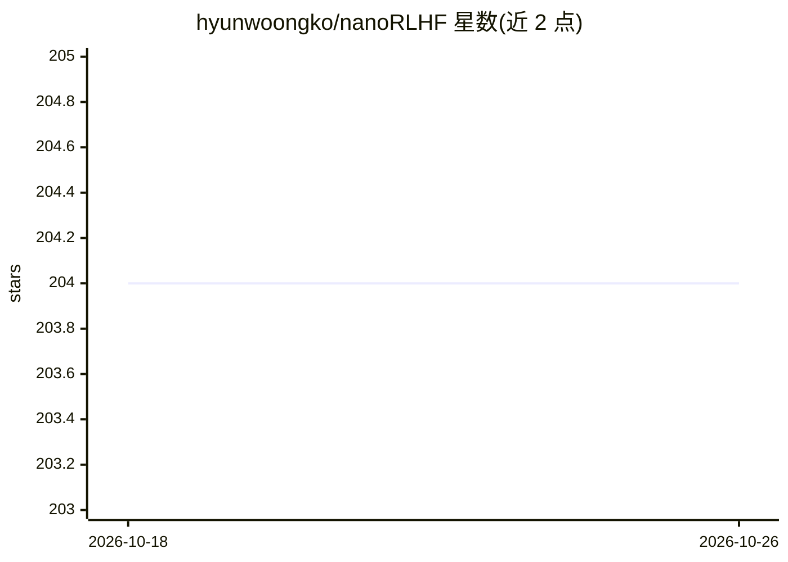

# hyunwoongko/nanoRLHF

⭐ 204 · Python · Apache-2.0 · 推送 2026-10-07 · [GitHub](https://github.com/hyunwoongko/nanoRLHF) · 个人维护

**面向学习者的从零实现 RLHF 训练全流程框架**

教学导向的 RLHF 从零实现项目：除 PyTorch 和 Triton 外，各核心组件均手动实现，包括 Arrow 式零拷贝数据集库、分布式计算引擎、3D 并行引擎、Triton 内核、高性能推理引擎与 RLHF 训练框架。提供端到端流水线：在 Qwen3-0.6B 上用 NuminaMath-CoT 数据做 SFT、用 DeepMath-103K 数据做 PPO 强化学习，并以 MATH-500 评测。面向想理解大规模训练系统原理的开发者与学习者。限制：仅支持单机多 GPU，完整体验 3D 并行需至少 8 张 GPU（开发环境为 8×H200），非生产就绪。

## 筛选速览

| 维度 | 判定 | 备注 |
|---|---|---|
| AI 角色 | `ai-ecosystem` | LLM/agent 周边工具 |
| 许可风险 | `permissive` | Apache-2.0 |
| 部署形态 | `None` |  |
| 模型依赖 | — | README 未给出锁定关系 |
| 硬件要求 | — | 无带数字的原话,不猜 |
| 安装摩擦 | `low` | 无编译、无系统依赖或容器化 |
| 成熟度 | — | 结构信号不足 |

## 能力要点

- 7 个模块分别从零实现：数据集库/分布式引擎/3D 并行/Triton 内核/推理引擎/RLHF 框架/完整流水线
- 支持 SFT + PPO 异步 RL 端到端训练 Qwen3-0.6B，附 MATH-500 评测结果
- 自研零拷贝 .nano 数据格式与 paged attention 推理引擎
- 除 PyTorch/Triton 外核心组件均为手写最小实现，聚焦教学清晰性

## 适用场景

- 逐模块学习大规模 LLM 训练系统（3D 并行、RLHF、推理引擎）的内部原理
- 在 8 GPU 服务器上完整跑通 SFT→RLHF→评测的参考实现
- 理解 PPO 与异步强化学习在 LLM 对齐中的实际结构

## 场景标签

`强化学习` `教程课程` · 领域:学习与行业

## 证据(README 行号)

> L7: This project aims to perform RLHF training from scratch, implementing almost all core components manually except for
> L77: `nanoverl` is a minimal RLHF training framework focusing on clarity.

## 星数曲线

2026-10-18 204 → 2026-10-26 204（+0）

---
*卡片 v1 · prompt 1.4 · 生成 2026-10-22 · 置信度 high · 依据 README sha `375f45cb6e57` · [字段定义](../../DATASET.md)*
