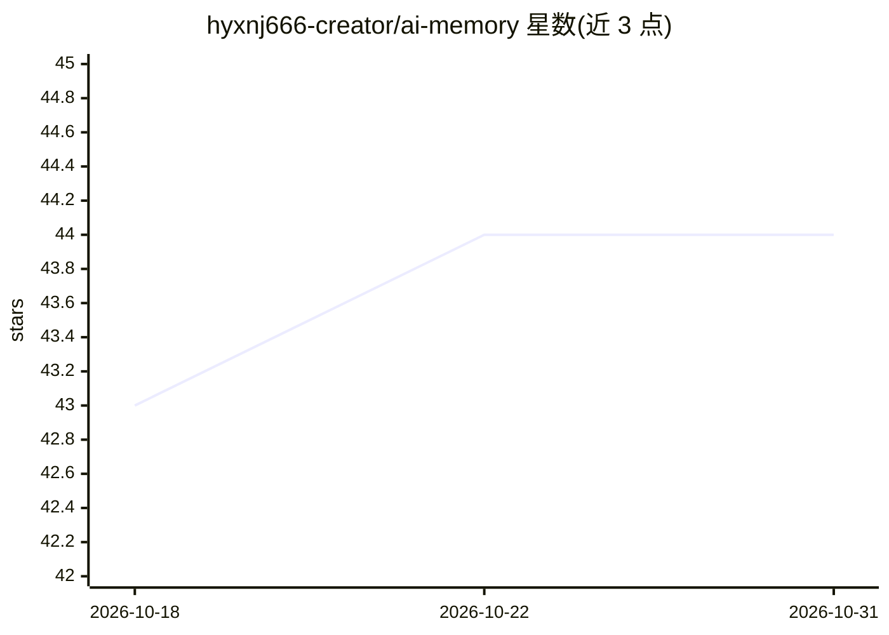

# hyxnj666-creator/ai-memory

⭐ 44 · TypeScript · MIT · 推送 2026-05-07 · [GitHub](https://github.com/hyxnj666-creator/ai-memory) · [官网](https://www.npmjs.com/package/ai-memory-cli) · 个人维护 · 中文 README

**把 AI 编辑器对话记录提取为 git 可追踪 Markdown 记忆的开发者 CLI**

面向使用 Cursor、Claude Code、Windsurf、Copilot Chat、Codex CLI 的开发者：直接读取本地编辑器聊天记录，用 LLM 提取带类型的决策/架构/约定记忆，存为 .ai-memory/ 下的纯 Markdown，由 git 管理；并生成幂等合并的 AGENTS.md 供各 AI 编辑器读取。默认本地优先，支持 Ollama/LM Studio 离线运行，无 API key 时回退到内置免费模型（限 2 次对话/运行）。提供 recall 按提交历史追溯记忆演变、context 压缩上下文、doctor 健康检查等命令。

## 筛选速览

| 维度 | 判定 | 备注 |
|---|---|---|
| AI 角色 | `ai-ecosystem` | LLM/agent 周边工具 |
| 许可风险 | `permissive` | MIT |
| 部署形态 | `library` | 以包/库形式分发 |
| 模型依赖 | local-ok | 支持本地模型 |
| 硬件要求 | — | 无带数字的原话,不猜 |
| 安装摩擦 | `low` | 无编译、无系统依赖或容器化 |
| 成熟度 | — | 结构信号不足 |

## 能力要点

- 直接读取磁盘上的编辑器对话记录，无需在代码中调用记忆 API
- 生成幂等合并的 AGENTS.md，保留手写内容
- 记忆为纯 Markdown 入 git，recall 可逐提交追溯演变
- 内置免费模型回退（限 2 对话/运行），支持 Ollama/LM Studio 离线

## 适用场景

- 把 AI 结对编程中形成的决策沉淀为团队可评审的文档
- 跨会话/跨设备恢复 AI 编辑器上下文
- 审计某个技术决策何时被谁更改

## 场景标签

`Agent 记忆` · 领域:Agent 开发

## 证据(README 行号)

> L7: > Turn AI editor chat history into typed Markdown + `AGENTS.md` rules — local-first, git-trackable, zero `.remember(
> L18: Every other "AI memory" tool starts with a `remember()` API and asks you to instrument your code. **`ai-memory` rea
> L20: **Local-first by default.** Conversations never leave your machine; the only network call is to whichever LLM provi

## 星数曲线

2026-10-18 43 → 2026-10-31 44（+1）

---
*卡片 v1 · prompt 1.4 · 生成 2026-10-25 · 置信度 high · 依据 README sha `38c4534a2898` · [字段定义](../../DATASET.md)*
