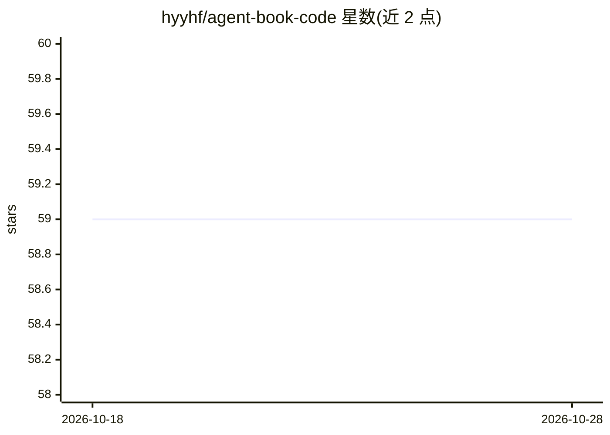

# hyyhf/agent-book-code

⭐ 59 · Python · MIT · 推送 2026-10-03 · [GitHub](https://github.com/hyyhf/agent-book-code) · 个人维护 · 中文 README

**教你从零手写 AI Agent 的实战书及配套可运行项目 FunHarness**

《从0开始构建 AI 智能体》配套代码仓库：11 章示例不依赖高层 Agent 框架，基于原始 LLM API 逐步实现 Agent Loop、工具系统、上下文管理、记忆、权限、Hooks、多 Agent 协作与可观测性，最终产物为可本地运行的 AI 编程助手 FunHarness（v01→v08 分版本演进）。FunHarness 提供 TUI 与面向学生的 Electron+FastAPI 本地 GUI（FunHarness Studio，暂支持 Windows），内置 30+ 工具、权限三档、持久任务图与飞书/QQ/微信机器人通道。配置仅需 Python、uv 和一个兼容 OpenAI 格式的模型 API。给想理解 Agent 内部机制的开发者与教学场景使用。限制：Studio 桌面构建目前仅支持 Windows。

## 筛选速览

| 维度 | 判定 | 备注 |
|---|---|---|
| AI 角色 | `ai-knowledge` | 知识聚合/清单类 |
| 许可风险 | `permissive` | MIT |
| 部署形态 | `library` | 以包/库形式分发 |
| 模型依赖 | — | README 未给出锁定关系 |
| 硬件要求 | — | 无带数字的原话,不猜 |
| 安装摩擦 | `low` | 无编译、无系统依赖或容器化 |
| 成熟度 | — | 结构信号不足 |

## 能力要点

- 11 章从零构建，不依赖高层 Agent 框架，完全基于原始 LLM API
- FunHarness 从 v01 到 v08 逐版本演进，每章代码可独立运行
- 内置 30+ 工具、权限三档、持久任务图、SubAgent/Agent Team 与可观测性面板
- TUI 与 Electron+FastAPI 本地 GUI 共享同一套 Agent Core，支持飞书/QQ/微信通道

## 适用场景

- 跟着章节亲手搭建一个类 Claude Code 的 AI 编程助手
- 在课堂上演示和观察 Agent 的工具调用、任务拆解与权限流程
- 在 FunHarness 基础上替换工具与提示词，打造自己的 Agent

## 场景标签

`教程课程` `编码 Agent` `多智能体` · 领域:Agent 开发

## 证据(README 行号)

> L35: 本书是一本**从零开始构建 AI 智能体**的实战教材。不依赖任何高层 Agent 框架，完全基于原始 LLM API，带领读者一步一步手写出一个具备工具调用、上下文管理、权限控制、可观测性的 AI 编程助手**FunHarnes
> L37: 它不是一本只展示 API 调用片段的教程，也不是一本只讲概念的 Agent 读物。本书更像一条可运行、可拆解、可复现的工程路线：先从一次最小 LLM 调用开始，理解消息、流式输出和函数调用；再逐步加入 Agent Loop、工具系
> L39: 这也是本书与普通示例代码最大的区别：读者不是“看完一个项目”，而是跟着项目的演进过程，亲手把一个类 **“Claw” AI Agent** 搭出来。每一章都有对应的中间版本，每一次新增能力都能被运行、对比和修改。到最后，FunHa

## 星数曲线

2026-10-18 59 → 2026-10-28 59（+0）

---
*卡片 v1 · prompt 1.4 · 生成 2026-10-24 · 置信度 low · 依据 README sha `f852513213ea` · [字段定义](../../DATASET.md)*
