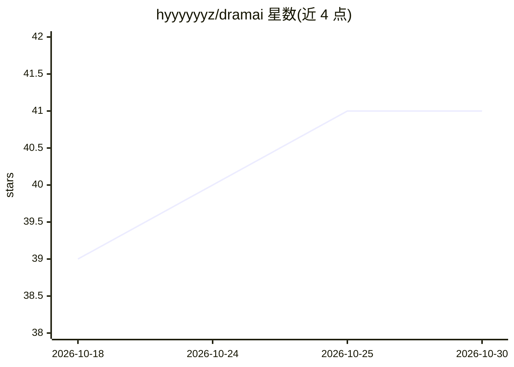

# hyyyyyyz/dramai

⭐ 41 · TypeScript · Apache-2.0 · 推送 2026-05-04 · [GitHub](https://github.com/hyyyyyyz/dramai) · [官网](https://hyyyyyyz.github.io/dramai/) · 个人维护 · 中文 README

**浏览器内运行的 AI 短剧创作工具，文本到成片全流程**

纯前端、零后端的 AI 短剧创作工具：读取 doc/txt/md 文档与参考图，调用用户自配的 OpenAI 兼容 API 生成结构化分镜脚本，再逐分镜文生图、图生视频，用 FFmpeg.wasm 在浏览器内合成成片，可导出 SRT 字幕与剪映（CapCut）草稿 ZIP。支持角色卡绑定参考图以保持形象一致，API Key 不经过中间服务器。用户自行向 DeepSeek、302.AI 等服务商充值，当前不生成旁白音频，需在剪映中添加配音。可 fork 后部署到 GitHub Pages。

## 筛选速览

| 维度 | 判定 | 备注 |
|---|---|---|
| AI 角色 | `ai-native` | 本体是模型或模型工具 |
| 许可风险 | `permissive` | Apache-2.0 |
| 部署形态 | `library` | 以包/库形式分发 |
| 模型依赖 | locked-api |  |
| 硬件要求 | — | 无带数字的原话,不猜 |
| 安装摩擦 | `medium` | 含编译或系统依赖之一 |
| 成熟度 | — | 结构信号不足 |

## 能力要点

- 文本/文档/参考图 → 分镜 → 生图 → 生视频 → 成片的浏览器内 Pipeline
- 角色卡绑定参考图保持多分镜形象一致
- FFmpeg.wasm 浏览器内合成成片，导出 SRT 与剪映草稿 ZIP
- 零后端，fork 后启用 GitHub Pages 即可私有部署

## 适用场景

- 把已有的故事文稿自动改编成带分镜图的短剧视频
- 制作多个角色形象一致的系列短剧片段
- 导出剪映草稿后自行配音和二次剪辑

## 场景标签

`图像生成` `视频生成` · 领域:内容生成

## 证据(README 行号)

> L19: `dramai` 是一个**完全跑在浏览器里的 AI 短剧创作工具**：
> L23: - 它会调用你自己配置的 OpenAI 兼容 API，先生成结构化分镜脚本；
> L24: - 然后逐个分镜生图、生成视频片段、合成成片；

## 星数曲线

2026-10-18 39 → 2026-10-30 41（+2）

---
*卡片 v1 · prompt 1.4 · 生成 2026-10-25 · 置信度 high · 依据 README sha `368c46340fc2` · [字段定义](../../DATASET.md)*
