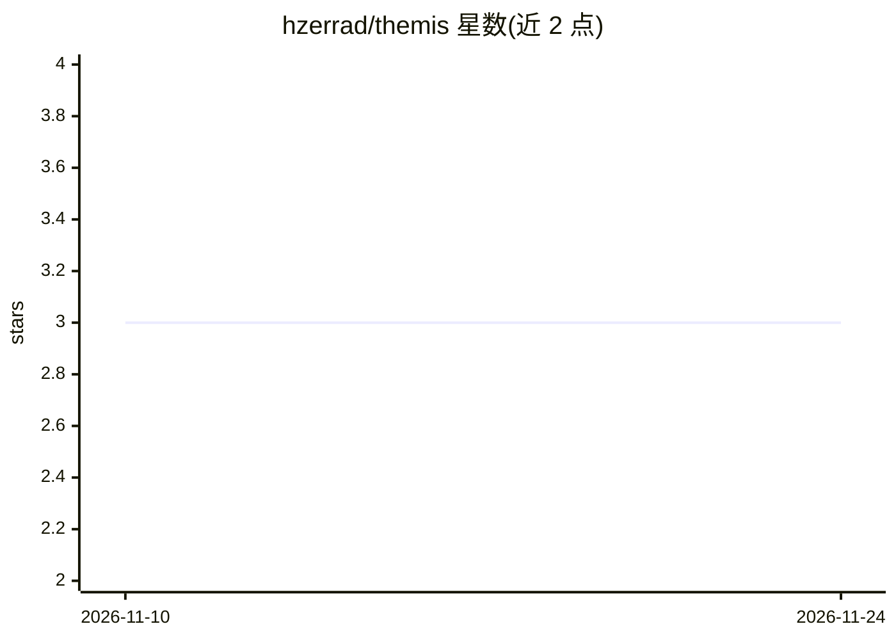

# hzerrad/themis

⭐ 3 · Go · Apache-2.0 · 推送 2026-11-16 · [GitHub](https://github.com/hzerrad/themis) · 个人维护

**为 AI 提议的 Kubernetes 修复提供治理与审批的引擎**

Themis 将 Kubernetes 告警转为事件，从集群收集证据，并对修复提议做治理判定：提议可来自工程师、外部 AI SRE agent（如 HolmesGPT）或内置调查器，只有在校验通过、策略允许且人工批准后才会执行，随后验证结果。治理部分确定性运行（CEL 检查与策略，不依赖模型），AI 部分可替换；默认只读、无写权限，executor 是唯一可写组件。需 Kubernetes 1.35–1.37、Helm 与 Alertmanager，当前为 alpha 版本。

## 筛选速览

| 维度 | 判定 | 备注 |
|---|---|---|
| AI 角色 | `ai-enhanced` | 去掉 AI 部分产品仍成立 |
| 许可风险 | `permissive` | Apache-2.0 |
| 部署形态 | `library` | 以包/库形式分发 |
| 模型依赖 | locked-api |  |
| 硬件要求 | — | 无带数字的原话,不猜 |
| 安装摩擦 | `low` | 无编译、无系统依赖或容器化 |
| 成熟度 | `idea` | |

## 能力要点

- 确定性治理：CEL 检查、策略与人工审批，模型不持有写权限
- 提议与治理分离：外部 agent 提议不可信，校验在 Themis 自采证据上运行
- 内置调查器默认只从修复目录出提案，可更换为外部 AI SRE agent
- 91 个合成评估用例，含证据注入诱导场景，未出现有害修复到达人工

## 适用场景

- 为 AI SRE agent 的修复建议加审批与策略门槛
- 将 Alertmanager 告警转为可治理的 Kubernetes 事件
- 在受控命名空间内自动执行并验证已批准的回滚或资源变更

## 场景标签

`工作流自动化` · 领域:效率与自动化

## 证据(README 行号)

> L21: |Works from|The evidence Themis collected, and an LLM|Cluster state, CEL checks and CEL policy. No model|
> L128: - A read-only default, with no model and no write access. Evidence and checks still run, and fixes come from engin
> L145: |`themis-intelligence`|Python|The built-in investigator, for teams without an AI SRE agent: a bounded loop over th

## 星数曲线

2026-11-10 3 → 2026-11-24 3（+0）

---
*卡片 v1 · prompt 1.4 · 生成 2026-11-21 · 置信度 high · 依据 README sha `8673399812a5` · [字段定义](../../DATASET.md)*
