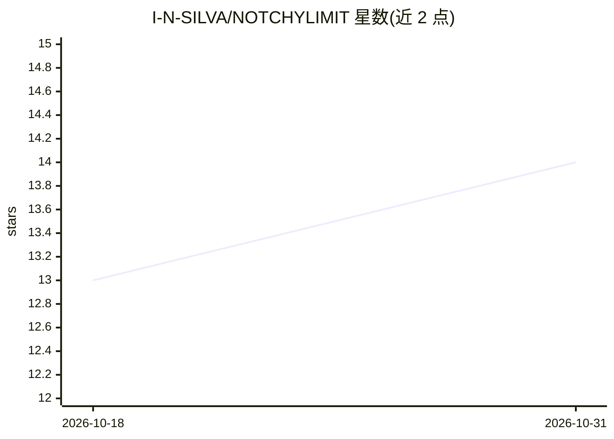

# I-N-SILVA/NOTCHYLIMIT

⭐ 14 · Swift · MIT · 推送 2026-07-13 · [GitHub](https://github.com/I-N-SILVA/NOTCHYLIMIT) · [官网](https://notchylimit.com/) · 个人维护

**在 MacBook 刘海/菜单栏实时显示 8 家 AI 服务用量额度的 macOS 工具**

原生 Swift 编写的 macOS 菜单栏应用（无 Dock 图标），将 MacBook 硬件刘海变为 AI 用量监控胶囊：悬停展开面板显示会话百分比、周额度、重置倒计时与阈值通知，支持无刘海 Mac 的菜单栏模式。追踪 Claude、Codex、Gemini、OpenAI、OpenRouter、DeepSeek、ElevenLabs、Perplexity 8 家服务；Claude/Codex/Gemini 自动读取官方 CLI 已存登录凭据，无需 API key。本地运行、零遥测，令牌存于 macOS 钥匙串。注意其读取各服务未公开的内部用量端点，端点变更可能导致功能失效。提供 Homebrew、DMG 与源码编译三种安装方式。

## 筛选速览

| 维度 | 判定 | 备注 |
|---|---|---|
| AI 角色 | `ai-ecosystem` | LLM/agent 周边工具 |
| 许可风险 | `permissive` | MIT |
| 部署形态 | `desktop` | 安装包/桌面程序 |
| 模型依赖 | — | README 未给出锁定关系 |
| 硬件要求 | — | 无带数字的原话,不猜 |
| 安装摩擦 | `low` | 无编译、无系统依赖或容器化 |
| 成熟度 | — | 结构信号不足 |

## 能力要点

- 刘海胶囊 + 悬停展开面板，Dynamic Island 风格
- 追踪 8 家 AI 服务用量；Claude/Codex/Gemini 免 key 自动读取 CLI 登录
- 25/50/75/90% 阈值通知、5 分钟自动刷新、故障状态徽标
- 本地优先、零遥测，令牌存 Keychain；UsageProvider 协议可扩展新服务

## 适用场景

- 在使用 Claude Code / Codex 编码时随时看到剩余额度，避免切页面刷新
- 在无刘海 Mac 上通过菜单栏同时查看多家 AI 服务用量
- 接近额度上限时收到通知提醒

## 场景标签

 · 领域:桌面工具/AI 用量监控

## 证据(README 行号)

> L14: NOTCHY is a free, open-source macOS utility that turns the MacBook hardware notch (or the menu bar) into a real-tim
> L16: **Tracks 8 providers:** **Claude** (Claude Code / Claude.ai — real 5h + weekly), **Codex** (ChatGPT plan — real 5h 
> L47: - Provider-extensible with a clean `UsageProvider` protocol

## 星数曲线

2026-10-18 13 → 2026-10-31 14（+1）

---
*卡片 v1 · prompt 1.4 · 生成 2026-10-31 · 置信度 mid · 依据 README sha `488fa373cfb4` · [字段定义](../../DATASET.md)*
