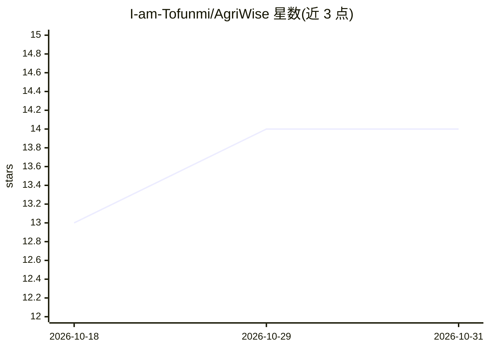

# I-am-Tofunmi/AgriWise

⭐ 14 · CSS · 推送 2026-04-15 · [GitHub](https://github.com/I-am-Tofunmi/AgriWise) · [官网](https://agri-wise-dusky.vercel.app) · 个人维护

**面向非洲小农户的智慧农业平台：AI 病害识别+天气市场数据**

面向非洲小农户的 Web 平台，整合三项能力：上传作物图片获得病害识别与管理建议的 AI 检测、实时天气预报与商品市场价格、农民社区网络与登录系统。前端用 HTML5/CSS3/原生 JavaScript 构建，部署在 Vercel，提供在线演示，适配移动端与桌面端。README 未列出 AI 模型细节、后端或本地安装步骤，页面结构与样式文件构成项目主体。

## 筛选速览

| 维度 | 判定 | 备注 |
|---|---|---|
| AI 角色 | `ai-native` | 本体是模型或模型工具 |
| 许可风险 | `none` | — |
| 部署形态 | `None` |  |
| 模型依赖 | — | README 未给出锁定关系 |
| 硬件要求 | — | 无带数字的原话,不猜 |
| 安装摩擦 | `low` | 无编译、无系统依赖或容器化 |
| 成熟度 | — | 结构信号不足 |

## 能力要点

- 上传作物图片获得 AI 病害识别与管理建议
- 实时天气预报与商品市场价格数据
- 农民社区网络与登录注册系统
- 响应式设计，适配移动端与桌面端

## 适用场景

- 上传作物照片识别病害并获取管理建议
- 查看天气预报和市场价格以安排农事与销售
- 在社区中与其他农民交流并获取专家支持

## 场景标签

`目标检测` · 领域:感知与多模态

## 证据(README 行号)

> L5: AgriWise is a smart agriculture support platform built to bridge the technology gap for smallholder farmers across A
> L13: - **AI-Powered Crop Disease Detection** — Upload an image of your crop and get instant disease identification and m

## 星数曲线

2026-10-18 13 → 2026-10-31 14（+1）

---
*卡片 v1 · prompt 1.4 · 生成 2026-10-31 · 置信度 mid · 依据 README sha `5bbbdab3de8f` · [字段定义](../../DATASET.md)*
