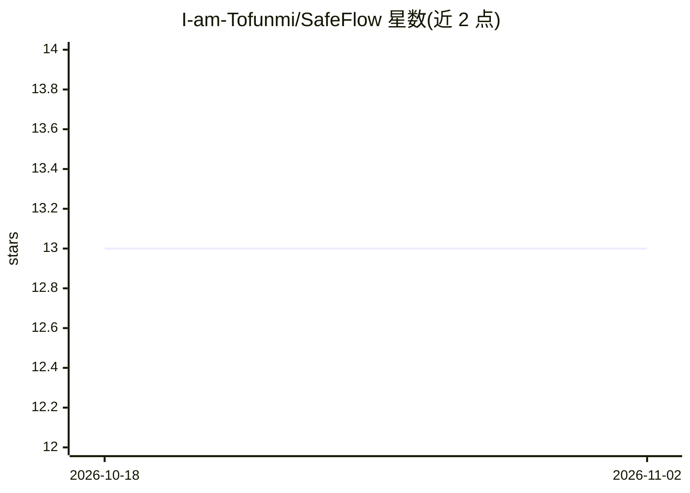

# I-am-Tofunmi/SafeFlow

⭐ 13 · HTML · 推送 2026-04-14 · [GitHub](https://github.com/I-am-Tofunmi/SafeFlow) · [官网](https://safe-flow-three.vercel.app) · 个人维护

**面向尼日利亚数字银行用户的 AI 金融安全应用**

SafeFlow 是一款为尼日利亚数字银行用户设计的金融安全应用，通过移动端 App 与 USSD 提供服务。功能包括：实时诈骗检测（监控交易模式与来件消息、标记钓鱼链接）、冲动消费提醒与预算/储蓄目标追踪、基于交易一致性/储蓄模式/社区背书的替代性信用评分 TrustScore，以及经过审核的金融产品目录。宣称 AI 基于尼日利亚本地诈骗模式训练。README 未给出安装运行方式；该项目建于拉各斯 Impact Hackathon。

## 筛选速览

| 维度 | 判定 | 备注 |
|---|---|---|
| AI 角色 | `ai-native` | 本体是模型或模型工具 |
| 许可风险 | `none` | — |
| 部署形态 | `None` |  |
| 模型依赖 | — | README 未给出锁定关系 |
| 硬件要求 | — | 无带数字的原话,不猜 |
| 安装摩擦 | `low` | 无编译、无系统依赖或容器化 |
| 成熟度 | — | 结构信号不足 |

## 能力要点

- 实时诈骗检测：监控交易模式与消息，标记钓鱼链接
- TrustScore 替代信用评分：无需抵押或文书
- 通过移动 App 与 USSD 双渠道提供
- 经审核的贷款/保险/储蓄团体目录

## 适用场景

- 在数字钱包使用中防范钓鱼诈骗与欺诈转账
- 追踪消费习惯并管理储蓄目标
- 无传统信用记录者通过 TrustScore 获取信用参考

## 场景标签

 · 领域:金融科技/消费者应用

## 证据(README 行号)

> L19: - 🚨 **Real-Time Scam Detection** — Monitors transaction patterns and incoming messages, flagging phishing links and
> L21: - 📊 **TrustScore** — Alternative credit scoring built from transaction consistency, savings patterns, and community

## 星数曲线

2026-10-18 13 → 2026-11-02 13（+0）

---
*卡片 v1 · prompt 1.4 · 生成 2026-10-31 · 置信度 mid · 依据 README sha `384b5166ec09` · [字段定义](../../DATASET.md)*
