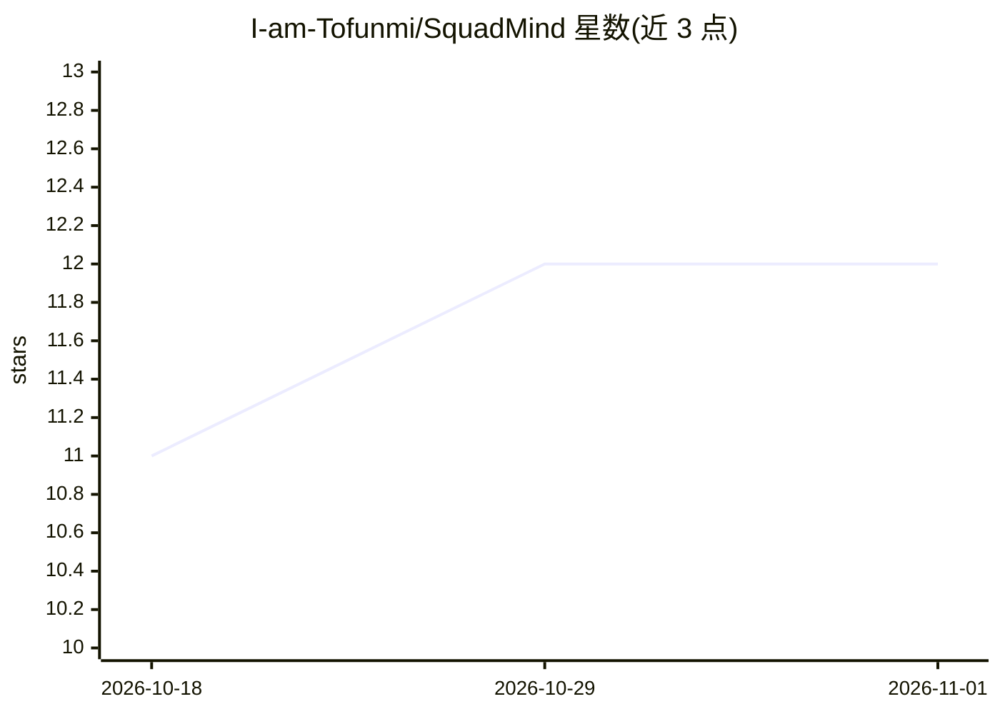

# I-am-Tofunmi/SquadMind

⭐ 12 · JavaScript · 推送 2026-05-16 · [GitHub](https://github.com/I-am-Tofunmi/SquadMind) · [官网](https://squadmind-khaki.vercel.app) · 组织维护

**面向尼日利亚中小商户的 AI 财务分析与信用评分平台**

构建于 Squad（HabariPay）支付 API 之上的财务智能平台，目标用户是通过 Squad 收款的尼日利亚非正规商户。读取商户 Squad 交易数据后提供两类输出：一是收入洞察仪表盘、欺诈与异常检测、30 天现金流预测、客户行为分析与英语/皮钦语的 AI CFO 助手；二是 TrustScore——基于交易历史生成的 0–100 信用分及可供贷款方的报告。技术栈为 React/Next.js、FastAPI、PostgreSQL/Redis、Scikit-learn 与 Prophet。README 未提供安装或运行命令，项目为 Squad Hackathon 3.0 参赛作品。

## 筛选速览

| 维度 | 判定 | 备注 |
|---|---|---|
| AI 角色 | `ai-native` | 本体是模型或模型工具 |
| 许可风险 | `none` | — |
| 部署形态 | `None` |  |
| 模型依赖 | — | README 未给出锁定关系 |
| 硬件要求 | — | 无带数字的原话,不猜 |
| 安装摩擦 | `low` | 无编译、无系统依赖或容器化 |
| 成熟度 | — | 结构信号不足 |

## 能力要点

- 从 Squad 交易数据生成收入洞察、欺诈检测与 30 天现金流预测
- TrustScore：0–100 AI 信用评分与一键下载贷款报告
- AI CFO 助手支持英语与皮钦语
- 接入 Squad 支付网关、虚拟账户、转账 API 与 Webhooks

## 适用场景

- 商户通过仪表盘查看收入与欺诈预警
- 无银行流水的商户凭交易历史获取信用报告申请贷款
- 用对话式 CFO 助手了解经营状况

## 场景标签

`数据分析` `聊天机器人` · 领域:效率与自动化

## 证据(README 行号)

> L30: An AI CFO that gives merchants real-time revenue
> L35: An AI credit score from 0–100 built entirely from

## 星数曲线

2026-10-18 11 → 2026-11-01 12（+1）

---
*卡片 v1 · prompt 1.4 · 生成 2026-11-01 · 置信度 high · 依据 README sha `a24180223384` · [字段定义](../../DATASET.md)*
