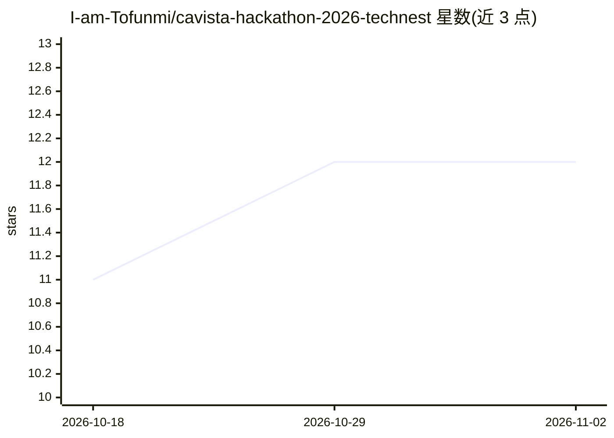

# I-am-Tofunmi/cavista-hackathon-2026-technest

⭐ 12 · HTML · 推送 2026-05-04 · [GitHub](https://github.com/I-am-Tofunmi/cavista-hackathon-2026-technest) · [官网](https://cavista-hackathon-2026-technest-tl1.vercel.app/) · 组织维护

**面向老年人的语音优先健康支持 Web 系统（黑客松项目）**

为 Cavista Hackathon 2026 构建的 Web 健康支持系统，服务 60 岁以上数字技能有限的老年用户及远程照护者。功能包括语音/视觉用药提醒与漏服追踪、每日健康打卡、非活动检测、一键紧急呼叫照护者，以及照护者仪表盘与警报。AI 层负责模式识别、风险评分与偏差检测，将日常交互数据转为预防性干预。支持英语、约鲁巴语、伊博语、豪萨语四种语言的语音交互。README 为 MVP 范围说明，未给出安装运行命令。

## 筛选速览

| 维度 | 判定 | 备注 |
|---|---|---|
| AI 角色 | `ai-enhanced` | 去掉 AI 部分产品仍成立 |
| 许可风险 | `none` | — |
| 部署形态 | `None` |  |
| 模型依赖 | — | README 未给出锁定关系 |
| 硬件要求 | — | 无带数字的原话,不猜 |
| 安装摩擦 | `low` | 无编译、无系统依赖或容器化 |
| 成熟度 | — | 结构信号不足 |

## 能力要点

- 语音优先交互与大按钮极简界面，适配低数字素养用户
- 用药提醒、健康打卡、非活动检测、紧急触发四类核心功能
- AI 层做模式识别、风险评分与偏差检测，触发照护者警报
- 英语、约鲁巴语、伊博语、豪萨语多语言语音支持

## 适用场景

- 提醒家中老人按时服药并追踪漏服情况
- 远程照护者通过仪表盘查看老人健康趋势与风险警报
- 老人长时间无交互时自动通知照护者

## 场景标签

`语音 Agent` · 领域:对话与助手

## 证据(README 行号)

> L25: - **AI analysis** - pattern detection and risk scoring
> L59: 3. AI builds baseline and detects deviations

## 星数曲线

2026-10-18 11 → 2026-11-02 12（+1）

---
*卡片 v1 · prompt 1.4 · 生成 2026-11-01 · 置信度 mid · 依据 README sha `d78deb640f9b` · [字段定义](../../DATASET.md)*
