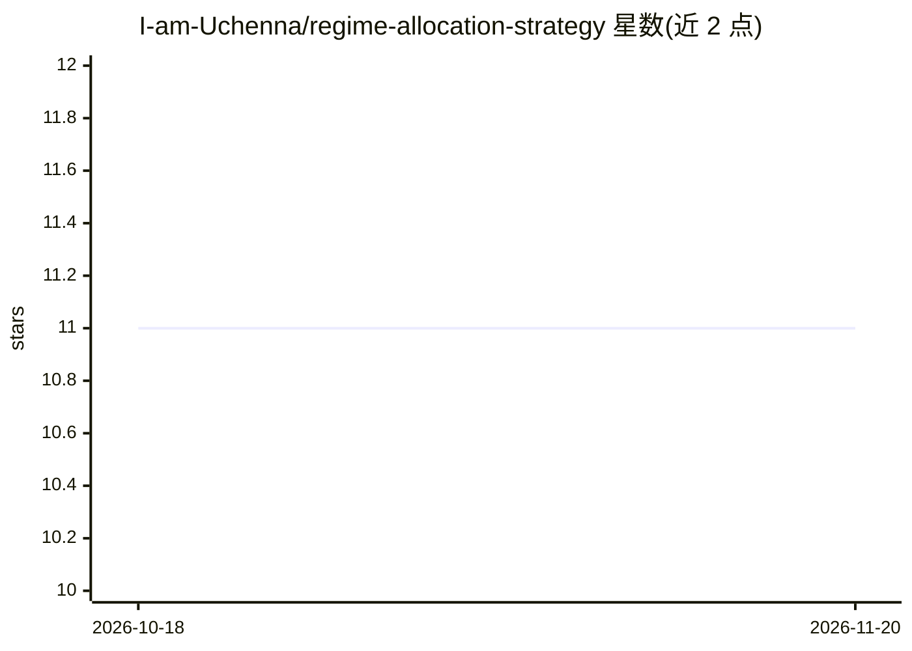

# I-am-Uchenna/regime-allocation-strategy

⭐ 11 · Jupyter Notebook · MIT · 推送 2026-01-18 · [GitHub](https://github.com/I-am-Uchenna/regime-allocation-strategy) · 个人维护

**HMM 识别 VIX 波动率状态并在三只 ETF 间轮动的量化配置策略**

以 Python 脚本实现的系统性多资产配置策略：用 yfinance 获取 TLT/GLD/SPY/^VIX 日线数据，先对 ΔVIX 做分位数离散化的马尔可夫链分析，再用 Gaussian HMM（Baum-Welch 估计、Viterbi 解码、AIC/BIC 选模）识别高/低波动两个状态，按状态条件收益映射到确定性配置规则（低波动持 SPY、高波动持 TLT），回测含 1 天执行延迟。输出性能指标表、对比基准（等权组合、买入持有 SPY）与 PNG 可视化。交易成本未建模，作者已标注为局限。

## 筛选速览

| 维度 | 判定 | 备注 |
|---|---|---|
| AI 角色 | `ai-native` | 本体是模型或模型工具 |
| 许可风险 | `permissive` | MIT |
| 部署形态 | `library` | 以包/库形式分发 |
| 模型依赖 | — | README 未给出锁定关系 |
| 硬件要求 | — | 无带数字的原话,不猜 |
| 安装摩擦 | `low` | 无编译、无系统依赖或容器化 |
| 成熟度 | — | 结构信号不足 |

## 能力要点

- Gaussian HMM 两阶段建模：离散马尔可夫链 + Baum-Welch/Viterbi/AIC-BIC 选模
- 状态条件收益驱动的确定性配置规则，含 1 天执行延迟防前视偏差
- 完整回测指标套件：Sharpe/Sortino/Calmar/最大回撤及双基准对比
- 一键脚本运行，输出统计表与 5 张可视化 PNG

## 适用场景

- 回放研究基于 HMM 波动率状态的 ETF 轮动逻辑
- 复现该策略 2004-2026 回测并分析各状态资产表现
- 作为马尔可夫链与 HMM 在金融时序上的教学示例

## 场景标签

`金融量化` · 领域:学习与行业

## 证据(README 行号)

> L7: A quantitative trading strategy that leverages Hidden Markov Models to identify market volatility regimes and system
> L13: This repository implements a systematic regime-switching allocation framework that adapts portfolio positioning bas
> L67: #### Hidden Markov Model

## 星数曲线

2026-10-18 11 → 2026-11-20 11（+0）

---
*卡片 v1 · prompt 1.4 · 生成 2026-11-19 · 置信度 high · 依据 README sha `1701844b3d9d` · [字段定义](../../DATASET.md)*
