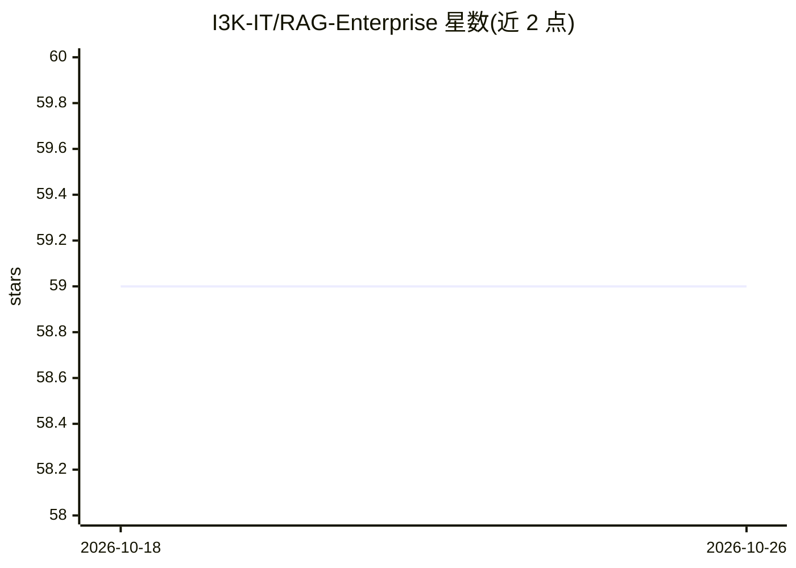

# I3K-IT/RAG-Enterprise

⭐ 59 · Rust · AGPL-3.0 · 推送 2026-10-20 · [GitHub](https://github.com/I3K-IT/RAG-Enterprise) · [官网](https://rag.i3k.eu) · 组织维护

**单二进制全本地自托管 RAG 系统：对自有文档提问并引用来源**

用 Rust 重写的自托管检索增强问答系统：单个二进制文件，首次运行自动下载并 sha256 校验 Qdrant、推理引擎 eullm、模型与 OCR 数据（约 12 GB），之后完全离线运行。支持上传 PDF/Office/邮件/图片等文档，经 Tesseract OCR、bge-m3 嵌入后存入 Qdrant，回答附带来源引用；含 JWT 多用户、每日备份、立法条文按文件名检索、自基准测试。面向因合规/隐私无法使用云 RAG 的律所、医疗、金融与公共机构。限制：HTTP 不终结 TLS，0.x 存储/接口未定型，1.x 数据无自动迁移。

## 筛选速览

| 维度 | 判定 | 备注 |
|---|---|---|
| AI 角色 | `ai-native` | 本体是模型或模型工具 |
| 许可风险 | `dual` | AGPL-3.0 |
| 部署形态 | `desktop` | 安装包/桌面程序 |
| 模型依赖 | — | README 未给出锁定关系 |
| 硬件要求 | — | 无带数字的原话,不猜 |
| 安装摩擦 | `low` | 无编译、无系统依赖或容器化 |
| 成熟度 | `idea` | |

## 能力要点

- 单二进制分发，自动拉起 Qdrant 与 eullm 推理进程，无需 Docker/Compose
- 首次运行后完全离线，所有组件 sha256 校验，无遥测
- 支持扫描 PDF/图片 OCR（Tesseract，意/英）、多格式文档解析与来源引用回答
- 自动检测 NVIDIA GPU 并分配 VRAM，无 GPU 则回退 CPU；含每日备份与恢复端点

## 适用场景

- 在自有服务器上对合同、法规等文档做带来源引用的问答
- 受合规/数据主权约束的机构部署不出内网的文档问答系统
- 对法律条文按条号精确检索（条文一文件一命名的馆藏）

## 场景标签

`文档问答` `文档解析` · 领域:知识与检索

## 证据(README 行号)

> L9: A self-hosted Retrieval-Augmented Generation system: upload your documents, ask
> L10: questions in plain language, get answers grounded in what those documents
> L11: actually say, with the sources cited. No data ever leaves your server — there
> L38: Built for people who cannot use cloud RAG for regulatory, privacy or
> L39: data-sovereignty reasons: law firms, healthcare, finance, public administration.

## 星数曲线

2026-10-18 59 → 2026-10-26 59（+0）

---
*卡片 v1 · prompt 1.4 · 生成 2026-10-24 · 置信度 mid · 依据 README sha `96ca13eb0337` · [字段定义](../../DATASET.md)*
