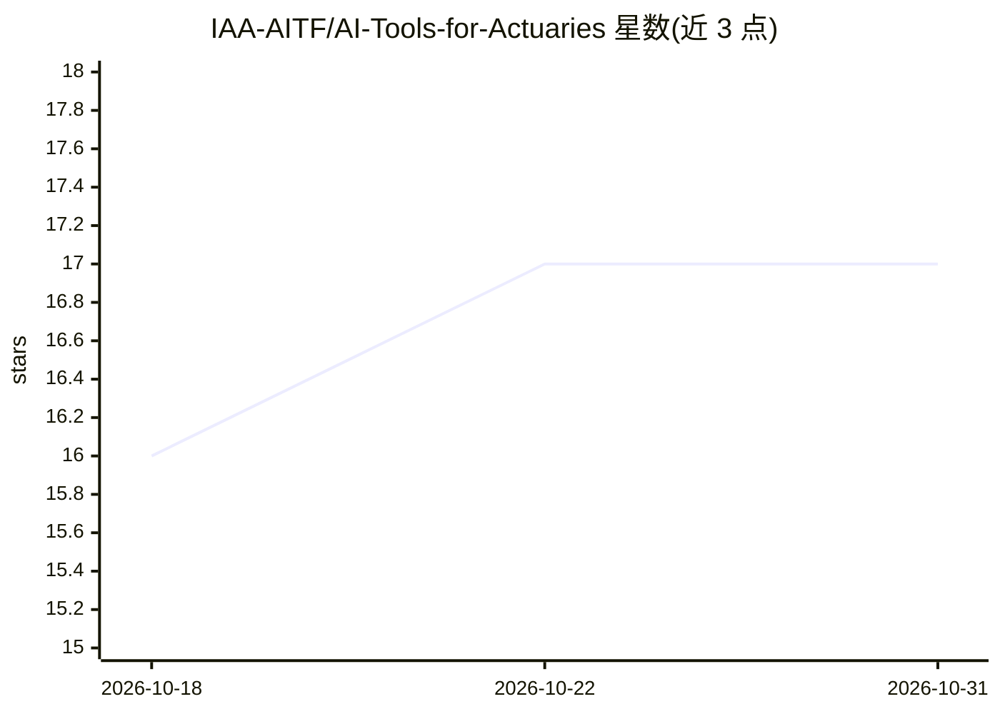

# IAA-AITF/AI-Tools-for-Actuaries

⭐ 17 · HTML · NOASSERTION · 推送 2026-05-25 · [GitHub](https://github.com/IAA-AITF/AI-Tools-for-Actuaries) · 组织维护

**面向精算师的 AI 工具教程与指南资源库**

由国际精算师协会（IAA）AI 任务组维护的资源中心，收录教程与指南，帮助精算师从基础 AI 界面过渡到构建程序化、可用于生产的 AI 方案。目前包含两个教程：doc_to_md 文档转 Markdown 工具包（Typer CLI、FastAPI 层、可插拔抽取引擎含 OCR，附带基准测试）和 GenAI Beyond the Basics（API 集成、结构化输出、函数调用、微调、RAG）。各教程独立成目录，格式涵盖 Jupyter notebook、视频讲解与文字指南。代码 MIT、内容 CC BY 4.0 双许可，接受社区投稿。

## 筛选速览

| 维度 | 判定 | 备注 |
|---|---|---|
| AI 角色 | `ai-knowledge` | 知识聚合/清单类 |
| 许可风险 | `permissive` | NOASSERTION |
| 部署形态 | `None` |  |
| 模型依赖 | — | README 未给出锁定关系 |
| 硬件要求 | — | 无带数字的原话,不猜 |
| 安装摩擦 | `low` | 无编译、无系统依赖或容器化 |
| 成熟度 | — | 结构信号不足 |

## 能力要点

- 由 IAA AI Task Force 维护的精算领域教程库
- doc_to_md：PDF/扫描件/Office 文档转 LLM 可用 Markdown 的工具包
- GenAI 教程覆盖 API 集成、结构化输出、函数调用、微调与 RAG
- 提供新教程提交模板与投稿指南

## 适用场景

- 精算师学习将 AI 工具应用于精算工作流
- 查找文档数字化与 RAG 等生产级 AI 方案教程
- 按模板提交自己编写的精算 AI 教程

## 场景标签

`教程课程` `文档解析` · 领域:知识与检索

## 证据(README 行号)

> L7: A resource hub of tutorials and guides for actuaries, created by the International Actuarial Association's (IAA) AI 

## 星数曲线

2026-10-18 16 → 2026-10-31 17（+1）

---
*卡片 v1 · prompt 1.4 · 生成 2026-10-30 · 置信度 high · 依据 README sha `fbba7955f20e` · [字段定义](../../DATASET.md)*
