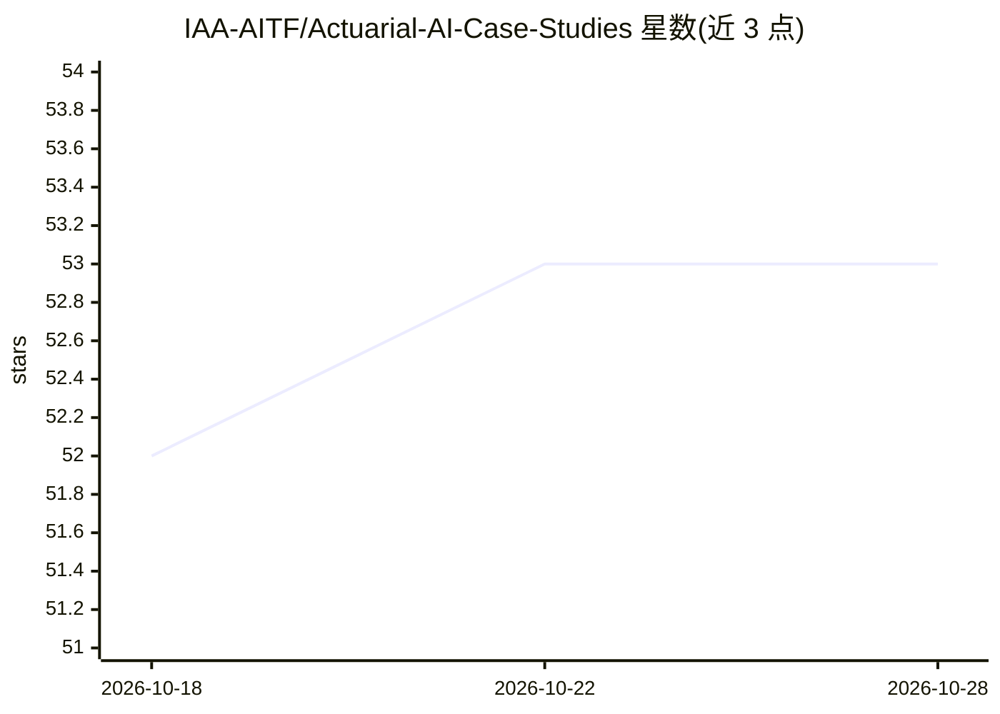

# IAA-AITF/Actuarial-AI-Case-Studies

⭐ 53 · HTML · NOASSERTION · 推送 2026-10-18 · [GitHub](https://github.com/IAA-AITF/Actuarial-AI-Case-Studies) · 组织维护

**国际精算协会 AI 工作组的精算 AI 案例研究合集**

由国际精算协会（IAA）AI 工作组维护的精算 AI 案例研究策展仓库，展示机器学习、生成式 AI、代理式 AI 在实际精算问题中的应用。收录案例涵盖车辆损伤分类定位、数据分析多智能体系统、RAG 市场比较、LLM 特征提取的理赔成本预测等，另维护含外部参考的目录索引。每个案例自带 README、Jupyter notebook 与 requirements.txt，可本地克隆运行或在 Google Colab/Kaggle 打开。内容采用 CC BY 4.0，代码采用 MIT 许可。

## 筛选速览

| 维度 | 判定 | 备注 |
|---|---|---|
| AI 角色 | `ai-knowledge` | 知识聚合/清单类 |
| 许可风险 | `permissive` | NOASSERTION |
| 部署形态 | `library` | 以包/库形式分发 |
| 模型依赖 | — | README 未给出锁定关系 |
| 硬件要求 | — | 无带数字的原话,不猜 |
| 安装摩擦 | `low` | 无编译、无系统依赖或容器化 |
| 成熟度 | — | 结构信号不足 |

## 能力要点

- 案例覆盖微调、视觉模型、多智能体、RAG 等主题
- 每个案例自包含：README + Jupyter notebook + requirements.txt
- 维护含外部参考的案例总目录
- 可在本地、Google Colab 或 Kaggle 运行

## 适用场景

- 精算师查找 AI 在精算场景的应用参考实现
- 学习车辆损伤识别、理赔成本预测等案例的做法
- 按年度浏览策展的精算 AI 案例目录

## 场景标签

`精选清单` · 领域:学习与行业

## 证据(README 行号)

> L7: A curated collection of actuarial AI case studies, created by the International Actuarial Association's (IAA) AI Tas
> L11: |Case Study|Topics|Level|

## 星数曲线

2026-10-18 52 → 2026-10-28 53（+1）

---
*卡片 v1 · prompt 1.4 · 生成 2026-10-24 · 置信度 mid · 依据 README sha `30f891bf7e4e` · [字段定义](../../DATASET.md)*
