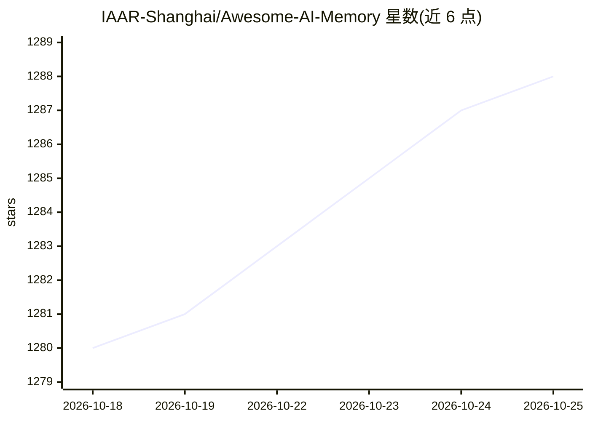

# IAAR-Shanghai/Awesome-AI-Memory

⭐ 1,289 · Python · Apache-2.0 · 推送 2026-10-23 · [GitHub](https://github.com/IAAR-Shanghai/Awesome-AI-Memory) · 组织维护 · 中文 README

**大模型/智能体记忆领域的论文与开源项目策展知识库**

由 IAAR-Shanghai 维护的 AI 记忆主题资源汇编仓库，系统收录与 LLM Memory、Agent Memory 相关的研究论文、综述、评测基准与开源项目，每篇论文附标签、链接与内容摘要。仓库界定明确收录范围：记忆须为论文核心研究问题并有语言模型研究对象，排除纯视觉机器人状态、KV 缓存效率与泛化 RAG 等相邻工作。面向研究者与工程实践者，持续按批次更新论文列表（单批最多 222 篇）。

## 筛选速览

| 维度 | 判定 | 备注 |
|---|---|---|
| AI 角色 | `ai-knowledge` | 知识聚合/清单类 |
| 许可风险 | `permissive` | Apache-2.0 |
| 部署形态 | `None` |  |
| 模型依赖 | — | README 未给出锁定关系 |
| 硬件要求 | — | 无带数字的原话,不猜 |
| 安装摩擦 | `low` | 无编译、无系统依赖或容器化 |
| 成熟度 | — | 结构信号不足 |

## 能力要点

- 系统收录大模型/智能体记忆领域的论文、综述、评测基准与开源项目
- 每篇论文附标签、arXiv 链接与三要点式中文摘要
- 明确的收录/排除范围界定（聚焦 Agent Memory 与语言模型内部记忆机制）
- 覆盖记忆存储/处理/检索/控制等核心概念的知识框架梳理

## 适用场景

- 研究者跟踪 LLM/Agent 记忆方向的论文脉络与综述
- 工程师查找记忆系统的设计方法与评测基准
- 构建长期记忆与持续推理系统前进行文献调研

## 场景标签

`精选清单` · 领域:学习与行业

## 证据(README 行号)

> L18: Awesome-AI-Memory 是一个围绕 AI 大模型记忆与记忆系统构建的资源汇编仓库，系统性地收集相关的研究论文、框架工具与实践经验。该仓库致力于梳理并呈现大模型记忆领域快速发展的研究脉络，连接自然语言处理、信息检索、智能
> L24: 本仓库聚焦 **Agent Memory 与语言模型内部记忆机制**。记忆必须是论文的核心研究问题，并有明确的语言模型或多模态语言模型研究对象。

## 星数曲线

2026-10-18 1,280 → 2026-10-25 1,288（+8）

---
*卡片 v1 · prompt 1.4 · 生成 2026-10-21 · 置信度 high · 依据 README sha `cd82850edc4e` · [字段定义](../../DATASET.md)*
