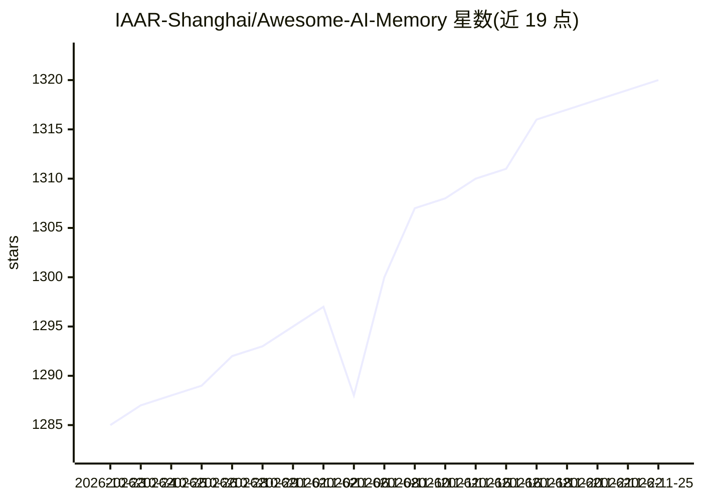

# IAAR-Shanghai/Awesome-AI-Memory

⭐ 1,320 · Python · Apache-2.0 · 推送 2026-11-20 · [GitHub](https://github.com/IAAR-Shanghai/Awesome-AI-Memory) · 组织维护 · 中文 README

**面向研究者与工程师的 LLM/Agent 记忆研究知识库**

围绕大模型记忆与记忆系统构建的资源汇编仓库，系统性收集相关研究论文、开源项目、框架工具与评测基准。内容包含核心概念梳理（记忆存储/处理/检索/控制四层架构、记忆操作与管理机制）以及按日期排列、附摘要与 arXiv 链接的论文列表，覆盖综述、方法、基准与系统类。仓库设有明确的收录筛选规则（记忆须为论文核心问题），持续更新并发布更新日志。以文档清单形式提供，无需安装运行。

## 筛选速览

| 维度 | 判定 | 备注 |
|---|---|---|
| AI 角色 | `ai-knowledge` | 知识聚合/清单类 |
| 许可风险 | `permissive` | Apache-2.0 |
| 部署形态 | `None` |  |
| 模型依赖 | — | README 未给出锁定关系 |
| 硬件要求 | — | 无带数字的原话,不猜 |
| 安装摩擦 | `low` | 无编译、无系统依赖或容器化 |
| 成熟度 | — | 结构信号不足 |

## 能力要点

- 系统性整理 LLM/Agent 记忆领域的论文、开源项目与评测基准
- 提供记忆系统核心概念的结构化梳理（四层架构、操作、分类体系）
- 设有论文筛选规则，收录内容须以记忆为核心研究问题
- 持续更新并附更新日志（方法/基准/系统分类统计）

## 适用场景

- 查找大模型记忆方向的研究论文与综述
- 调研 Agent 记忆系统的工程框架与设计模式
- 了解记忆领域的评测基准与安全研究进展

## 场景标签

`精选清单` `教程课程` · 领域:学习与行业

## 证据(README 行号)

> L18: Awesome-AI-Memory 是一个围绕 AI 大模型记忆与记忆系统构建的资源汇编仓库，系统性地收集相关的研究论文、框架工具与实践经验。该仓库致力于梳理并呈现大模型记忆领域快速发展的研究脉络，连接自然语言处理、信息检索、智能
> L24: 本仓库聚焦 **Agent Memory 与语言模型内部记忆机制**。记忆必须是论文的核心研究问题，并有明确的语言模型或多模态语言模型研究对象。
> L153: ## 📚 论文列表

## 星数曲线

2026-10-23 1,285 → 2026-11-25 1,320（+35）

---
*卡片 v1 · prompt 1.4 · 生成 2026-11-23 · 置信度 high · 依据 README sha `33308bf3f028` · [字段定义](../../DATASET.md)*
