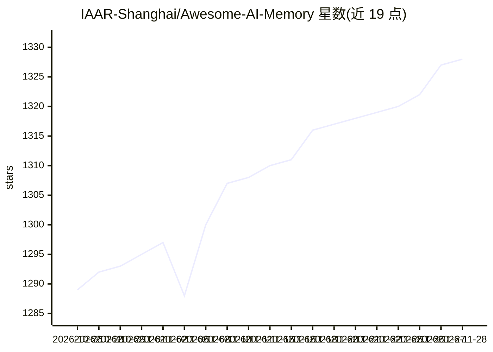

# IAAR-Shanghai/Awesome-AI-Memory

⭐ 1,328 · Python · Apache-2.0 · 推送 2026-11-24 · [GitHub](https://github.com/IAAR-Shanghai/Awesome-AI-Memory) · 组织维护 · 中文 README

**面向 LLM/智能体记忆研究的论文与项目知识库**

一个集中、持续更新的 AI 记忆领域资源汇编仓库，系统性收录大模型记忆与智能体记忆相关的研究论文、开源项目、评测基准与工程实践，按综述、方法/框架、数据集/基准、模型/系统等类别组织，并附论文筛选规则、收录范围说明与核心概念梳理（记忆分类、记忆操作、记忆检索与压缩等）。面向研究者与工程实践者提供文献参考，仓库以 MIT 许可发布，按日期滚动更新论文条目。

## 筛选速览

| 维度 | 判定 | 备注 |
|---|---|---|
| AI 角色 | `ai-knowledge` | 知识聚合/清单类 |
| 许可风险 | `permissive` | Apache-2.0 |
| 部署形态 | `None` |  |
| 模型依赖 | — | README 未给出锁定关系 |
| 硬件要求 | — | 无带数字的原话,不猜 |
| 安装摩擦 | `low` | 无编译、无系统依赖或容器化 |
| 成熟度 | — | 结构信号不足 |

## 能力要点

- 按综述/方法框架/基准/系统等类别组织论文条目并持续更新
- 提供论文筛选规则与收录范围（核心研究问题须为记忆机制）
- 梳理记忆存储/处理/检索/控制四层系统概念框架
- 同时收录相关开源项目与评测基准

## 适用场景

- 研究智能体长期记忆机制时查找相关论文
- 为记忆系统设计寻找开源框架与基准参考
- 跟踪大模型记忆方向的最新研究进展

## 场景标签

`精选清单` `科研工具` · 领域:学习与行业

## 证据(README 行号)

> L18: Awesome-AI-Memory 是一个围绕 AI 大模型记忆与记忆系统构建的资源汇编仓库，系统性地收集相关的研究论文、框架工具与实践经验。该仓库致力于梳理并呈现大模型记忆领域快速发展的研究脉络，连接自然语言处理、信息检索、智能
> L21: 本仓库的目标是构建一个集中、持续演进的知识库，为研究者与工程实践者提供参考，助力构建能够长期记忆、持续推理并随时间不断适应的智能系统。
> L154: ## 📚 论文列表

## 星数曲线

2026-10-26 1,289 → 2026-11-28 1,328（+39）

---
*卡片 v1 · prompt 1.4 · 生成 2026-11-26 · 置信度 high · 依据 README sha `d7eac4136542` · [字段定义](../../DATASET.md)*
