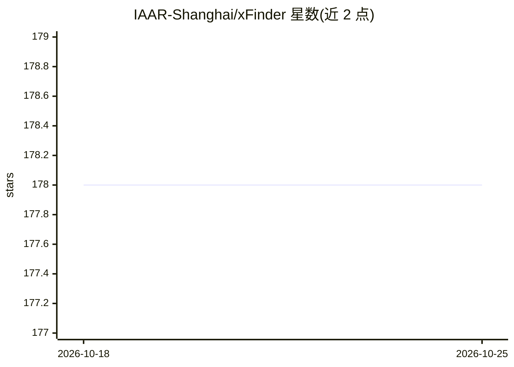

# IAAR-Shanghai/xFinder

⭐ 178 · Python · NOASSERTION · 推送 2025-11-14 · [GitHub](https://github.com/IAAR-Shanghai/xFinder) · [官网](https://openreview.net/forum?id=7UqQJUKaLM) · 组织维护 · 中文 README

**LLM 评测的关键答案抽取与匹配评测器，附 KAF 数据集**

ICLR 2025 论文配套开源项目：xFinder 是用于 LLM 评测链路中关键答案抽取与匹配的评测器，替代传统 RegEx 抽取方式，配套构建 KAF 数据集用于训练与测试。提供 xFinder-qwen1505 与 xFinder-llama38it 两个模型，支持中英文处理，以 PyPI 包与 Hugging Face 模型/数据集形式发布，可批量或单例评估，支持 vllm API 部署加载，并被 OpenCompass 集成。面向基准开发者和评测框架设计者。

## 筛选速览

| 维度 | 判定 | 备注 |
|---|---|---|
| AI 角色 | `ai-ecosystem` | LLM/agent 周边工具 |
| 许可风险 | `none` | NOASSERTION |
| 部署形态 | `library` | 以包/库形式分发 |
| 模型依赖 | local-ok | 支持本地模型 |
| 硬件要求 | — | 无带数字的原话,不猜 |
| 安装摩擦 | `low` | 无编译、无系统依赖或容器化 |
| 成熟度 | — | 结构信号不足 |

## 能力要点

- 替代 RegEx 的关键答案抽取与匹配模块，支持中英文
- 配套 KAF 数据集（开放于 Hugging Face）
- 提供批量评估与单例评估两种模式，可集成进评测框架
- 支持通过 vllm 部署的 API 方式加载

## 适用场景

- 基准开发中用 xFinder 替代 RegEx 抽取关键答案
- 评测框架设计者将其集成为答案抽取组件
- 对 LLM 输出做批量或逐条评估

## 场景标签

`模型评测` · 领域:评测与运维

## 证据(README 行号)

> L45: - **If you are developing a Benchmark**, you can use our xFinder to replace traditional RegEx methods for extractin
> L46: - **If you are a designer of evaluation frameworks**, you can integrate our xFinder into your framework's answer ex
> L69: - We introduce xFinder, a novel evaluator for answer extraction and matching in LLM evaluation, and construct the K

## 星数曲线

2026-10-18 178 → 2026-10-25 178（+0）

---
*卡片 v1 · prompt 1.4 · 生成 2026-10-23 · 置信度 high · 依据 README sha `4252332386c5` · [字段定义](../../DATASET.md)*
