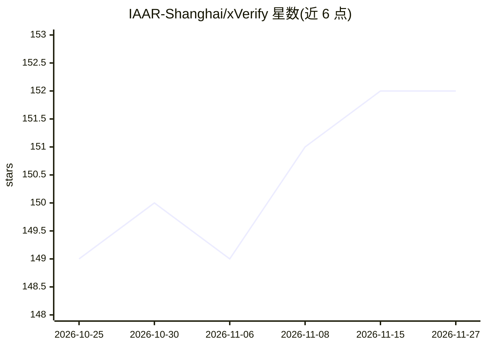

# IAAR-Shanghai/xVerify

⭐ 152 · Jupyter Notebook · NOASSERTION · 推送 2026-10-28 · [GitHub](https://github.com/IAAR-Shanghai/xVerify) · [官网](https://arxiv.org/abs/2504.10481) · 组织维护 · 中文 README

**判分模型工具：为推理模型评测提取并比对答案等价性**

xVerify 是从预训练大模型微调而来的答案判定工具，面向有唯一正确答案的客观题评测：从长推理链中抽取最终答案，再通过等价判断比对数学表达式、LaTeX、科学记数法与自然语言描述等多种表示形式。提供 0.5B–9B 参数的多变体模型（基于 Qwen 2.5、Gemma 2、LLaMA 3.x、GLM 4、Phi-4 系列微调），以 OpenAI API 兼容格式经 vLLM 部署，通过 Python Evaluator 支持单样本与批量评测，模型与 VAR 数据集在 Hugging Face 发布，采用 CC-BY-NC-ND-4.0 许可。

## 筛选速览

| 维度 | 判定 | 备注 |
|---|---|---|
| AI 角色 | `ai-native` | 本体是模型或模型工具 |
| 许可风险 | `none` | NOASSERTION |
| 部署形态 | `library` | 以包/库形式分发 |
| 模型依赖 | local-ok | 支持本地模型 |
| 硬件要求 | — | 无带数字的原话,不猜 |
| 安装摩擦 | `low` | 无编译、无系统依赖或容器化 |
| 成熟度 | — | 结构信号不足 |

## 能力要点

- 从长推理过程抽取最终答案并做数学表达式/LaTeX/自然语言等价判断
- 多选题评测可匹配选项内容而非仅匹配选项标签
- 提供 0.5B–9B 多种架构与基础模型变体以降低基础模型偏差
- 附带 VAR 训练/测试/泛化数据集与 demo.ipynb 评测示例

## 适用场景

- 对推理模型的数学题、选择题、分类题、简答题输出做批量判分
- 评测框架中替代正则匹配的答案等价性判定
- 低资源场景选用 0.5B 变体部署本地判分服务

## 场景标签

`模型评测` · 领域:评测与运维

## 证据(README 行号)

> L26: xVerify is an evaluation tool fine-tuned from a pre-trained large language model, designed specifically for objecti
> L42:  - **Flexible Model Size Selection**: Supports models ranging from 0.5B to 32B parameters, allowing users to choose

## 星数曲线

2026-10-25 149 → 2026-11-27 152（+3）

---
*卡片 v1 · prompt 1.4 · 生成 2026-11-27 · 置信度 high · 依据 README sha `7af40a268ee3` · [字段定义](../../DATASET.md)*
