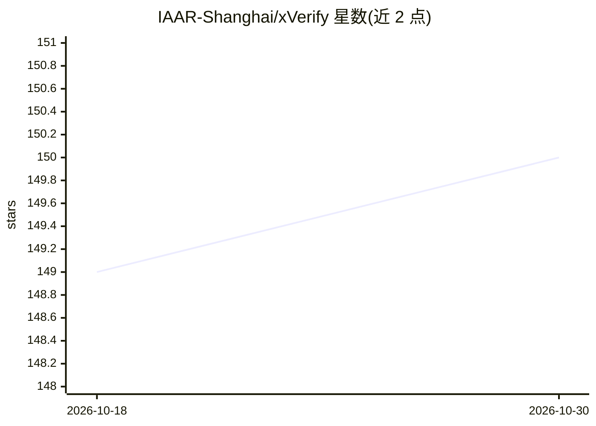

# IAAR-Shanghai/xVerify

⭐ 150 · Jupyter Notebook · NOASSERTION · 推送 2026-10-28 · [GitHub](https://github.com/IAAR-Shanghai/xVerify) · [官网](https://arxiv.org/abs/2504.10481) · 组织维护 · 中文 README

**面向推理模型评测的答案判定模型：抽取最终答案并判等价**

由 IAAR-Shanghai 发布的评测工具：从 LLM 长推理输出中抽取最终答案，并判定其与标准答案在不同表示形式（数学表达式、LaTeX、科学计数法、自然语言）下的等价性，支持数学题、选择题、分类题与简答题四类客观题评测。提供 0.5B–9B 多个基于 Qwen 2.5、Gemma 2、LLaMA 3.1/3.2、GLM 4 等基座的模型变体，通过 OpenAI API 兼容格式部署（推荐 vLLM），支持单样本与批量评测。许可为 CC-BY-NC-ND-4.0（非商业、不可演绎）。

## 筛选速览

| 维度 | 判定 | 备注 |
|---|---|---|
| AI 角色 | `ai-ecosystem` | LLM/agent 周边工具 |
| 许可风险 | `none` | NOASSERTION |
| 部署形态 | `library` | 以包/库形式分发 |
| 模型依赖 | local-ok | 支持本地模型 |
| 硬件要求 | — | 无带数字的原话,不猜 |
| 安装摩擦 | `low` | 无编译、无系统依赖或容器化 |
| 成熟度 | — | 结构信号不足 |

## 能力要点

- 从长推理链中抽取最终答案并做多表示形式等价判定
- 覆盖数学/选择题/分类/简答四类客观题，中英文为主
- 0.5B–9B 多个基座变体（Qwen 2.5、Gemma 2、LLaMA 3.x、GLM 4 等）
- 兼容 OpenAI API 格式部署，推荐 vLLM，支持单样本与批量评测

## 适用场景

- 评测推理模型在客观题上的回答正确性
- 替代正则匹配处理不同格式表达的答案比对
- 自动化批量评测 LLM 生成的回答

## 场景标签

`模型评测` · 领域:评测与运维

## 证据(README 行号)

> L23: xVerify is an evaluation tool fine-tuned from a pre-trained large language model, designed specifically for objecti
> L149: We collected widely used **LLM evaluation frameworks** and **judge models** to compare their performance with **xV

## 星数曲线

2026-10-18 149 → 2026-10-30 150（+1）

---
*卡片 v1 · prompt 1.4 · 生成 2026-10-23 · 置信度 mid · 依据 README sha `3809d1f1aced` · [字段定义](../../DATASET.md)*
