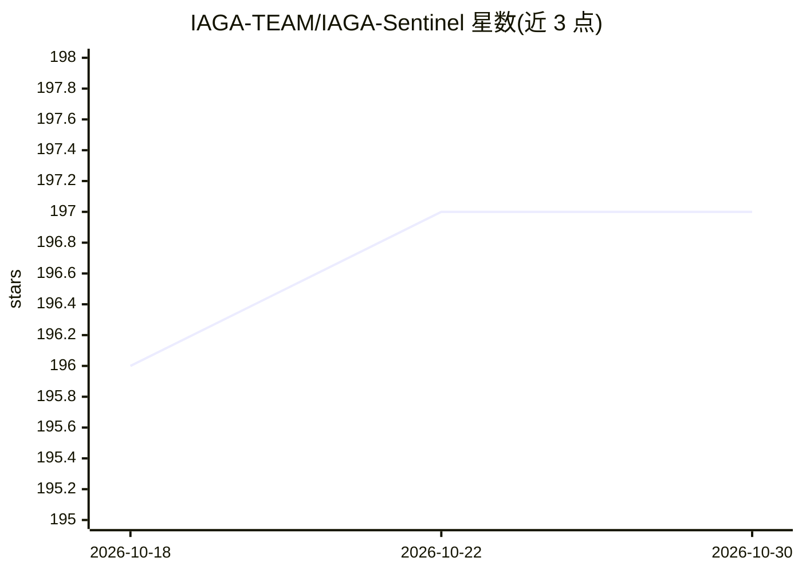

# IAGA-TEAM/IAGA-Sentinel

⭐ 197 · Rust · NOASSERTION · 推送 2026-09-11 · [GitHub](https://github.com/IAGA-TEAM/IAGA-Sentinel) · [官网](https://www.iaga.tech/) · 组织维护

**AI 代理合规证据层：为代理操作生成签名收据链，支持 EU AI Act 记录**

部署在 AI 代理栈旁（HTTP sidecar、MCP 代理或 iaga run），在动作执行前计算治理判定（allow/review/block）与风险评分，将每个判定铸成 Ed25519 签名收据并链入哈希链 append-log；提供独立 iaga-verify 二进制与 Python/TypeScript 依赖-free 校验器离线验证，支持确定性重放与漂移检测。收据结构对应 EU AI Act 第 12 条记录与 Annex IV 文档。限制：内核级隔离属 Enterprise 层，开源版收据标记 is_authoritative: false；默认 fail-open 模式下无法持久化的收据被丢弃。

## 筛选速览

| 维度 | 判定 | 备注 |
|---|---|---|
| AI 角色 | `ai-ecosystem` | LLM/agent 周边工具 |
| 许可风险 | `none` | NOASSERTION |
| 部署形态 | `self-host` | docker 或自建部署 |
| 模型依赖 | — | README 未给出锁定关系 |
| 硬件要求 | — | 无带数字的原话,不猜 |
| 安装摩擦 | `low` | 无编译、无系统依赖或容器化 |
| 成熟度 | — | 结构信号不足 |

## 能力要点

- 动作前治理判定（allow/review/block）与风险评分
- Ed25519 签名 + 哈希链收据，可用独立二进制离线验证
- 可被 AI 代理自身通过 MCP 自举部署（人工两次审批门）
- Dictum 类型化策略，iaga policy test 可针对真实 payload 测试

## 适用场景

- 为我的 AI 代理的操作留痕，应对审计或 DPO 询问
- 在动作执行前拦截高风险 shell 命令并生成可离线验证的证据
- 生成 EU AI Act Article 12 对应的记录与 Annex IV 文档材料

## 场景标签

`LLM 可观测性` · 领域:评测与运维

## 证据(README 行号)

> L55: AI agents touch the shell, the filesystem, databases, third-party APIs, and secrets. When a regulator, an auditor, 
> L146: the dashboard, connects itself over **MCP**, and puts its own actions under governance. Every tool call

## 星数曲线

2026-10-18 196 → 2026-10-30 197（+1）

---
*卡片 v1 · prompt 1.4 · 生成 2026-10-22 · 置信度 high · 依据 README sha `965b9ce04b5e` · [字段定义](../../DATASET.md)*
