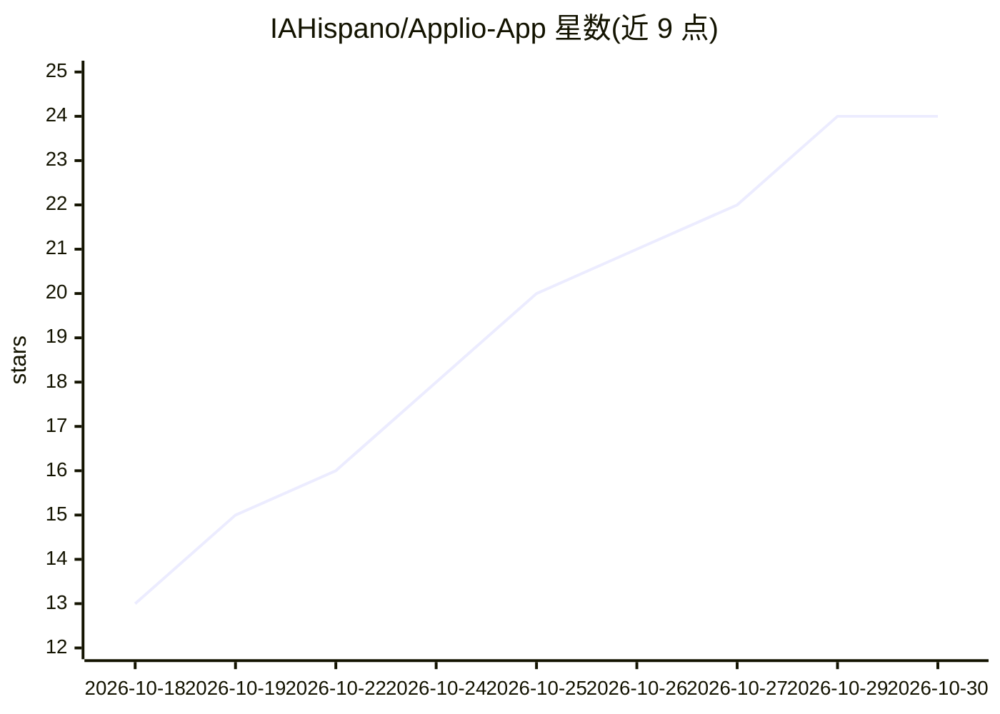

# IAHispano/Applio-App

⭐ 24 · Python · MIT · 推送 2026-10-29 · [GitHub](https://github.com/IAHispano/Applio-App) · [官网](applio.org) · 组织维护

**桌面端 AI 语音转换、实时变声、语音合成与模型训练应用**

Applio App 是基于 Tauri（React + Rust）的桌面应用，将语音转换、实时变声、语音合成与语音模型训练集成于单一应用。面向需要语音克隆/变声的终端用户：下载 Windows/macOS/Linux 构建后，在应用内选择 Install / Repair 并添加语音模型即可使用。开发者构建需 Node.js 22+、pnpm、Rust、Python 3.12、FFmpeg 及 Tauri 平台前置。MIT 许可。

## 筛选速览

| 维度 | 判定 | 备注 |
|---|---|---|
| AI 角色 | `ai-native` | 本体是模型或模型工具 |
| 许可风险 | `permissive` | MIT |
| 部署形态 | `library` | 以包/库形式分发 |
| 模型依赖 | — | README 未给出锁定关系 |
| 硬件要求 | — | 无带数字的原话,不猜 |
| 安装摩擦 | `medium` | 含编译或系统依赖之一 |
| 成熟度 | — | 结构信号不足 |

## 能力要点

- 单一桌面应用集成语音转换、实时变声、语音合成与模型训练
- 提供 Windows / macOS / Linux 官方构建下载
- 基于 Tauri（React + Rust）构建，支持浏览器 UI 开发模式

## 适用场景

- 离线进行语音转换与实时变声
- 训练自己的语音模型
- 在桌面端使用语音合成与语音克隆功能

## 场景标签

`语音合成` `模型训练` · 领域:内容生成

## 证据(README 行号)

> L3: Voice conversion, realtime voice changing, speech synthesis, and model training in one desktop app.
> L9: Download a build for Windows, macOS, or Linux. Open Applio, select **Install / Repair**, and add a voice model to ge

## 星数曲线

2026-10-18 13 → 2026-10-30 24（+11）

---
*卡片 v1 · prompt 1.4 · 生成 2026-10-27 · 置信度 mid · 依据 README sha `6dd92cb04ac8` · [字段定义](../../DATASET.md)*
