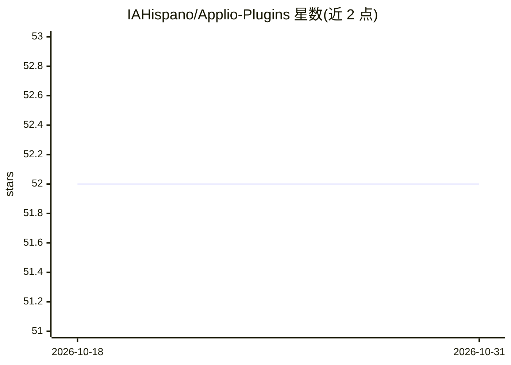

# IAHispano/Applio-Plugins

⭐ 52 · Python · 推送 2026-03-13 · [GitHub](https://github.com/IAHispano/Applio-Plugins) · [官网](https://applio.org) · 组织维护

**Applio 语音转换应用的插件仓库与开发模板**

IAHispano 维护的 Applio 插件集合仓库，同时充当插件开发起点：插件以 plugin.py 中的 def applio_plugin() 函数为核心，作为 Gradio 标签页接口被 Applio 导入；需保持函数名与文件名不变，可附 requirements 文件声明依赖。面向希望扩展 Applio（基于 RVC 的语音转换应用）功能的开发者和插件作者，README 亦号召社区提交新插件。

## 筛选速览

| 维度 | 判定 | 备注 |
|---|---|---|
| AI 角色 | `ai-ecosystem` | LLM/agent 周边工具 |
| 许可风险 | `none` | — |
| 部署形态 | `None` |  |
| 模型依赖 | — | README 未给出锁定关系 |
| 硬件要求 | — | 无带数字的原话,不猜 |
| 安装摩擦 | `low` | 无编译、无系统依赖或容器化 |
| 成熟度 | `idea` | |

## 能力要点

- 以 def applio_plugin() 函数作为 Gradio 标签页接口
- 要求保留 plugin.py 文件名与函数名以供导入
- 支持附带 requirements 文件声明插件依赖

## 适用场景

- 为 Applio 开发并提交自己的插件
- 浏览社区已收录的 Applio 插件

## 场景标签

 · 领域:语音转换/插件生态

## 证据(README 行号)

> L6: Welcome to **Applio Plugins**, a repository specifically designed for Applio plugins.
> L12: - The core of the plugin lies in the `def applio_plugin()` function, acting as the interface for the Gradio tab. *T

## 星数曲线

2026-10-18 52 → 2026-10-31 52（+0）

---
*卡片 v1 · prompt 1.4 · 生成 2026-10-24 · 置信度 mid · 依据 README sha `025d91e70253` · [字段定义](../../DATASET.md)*
