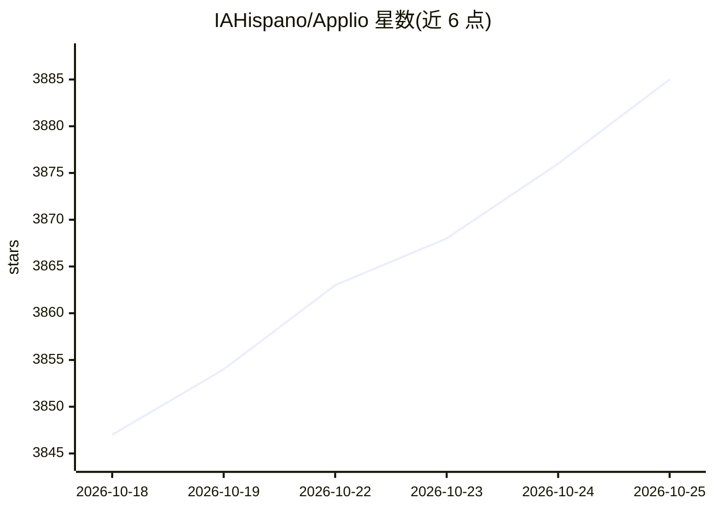

# IAHispano/Applio

⭐ 3,890 · Python · MIT · 推送 2026-10-24 · [GitHub](https://github.com/IAHispano/Applio) · [官网](https://applio.org) · 组织维护

**语音转换工具：基于 RVC 的高质量变声/克隆**

基于 PyTorch 的语音转换（RVC/VITS 路线）工具，面向艺术家、开发者与研究者，通过 Gradio 网页界面进行模型训练与语音转换，支持插件与配置扩展。安装方式为各平台安装脚本（run-install.bat/.sh）与 Windows 编译版，另有 Google Colab 版本与可选 TensorBoard 训练监控。源码与模型权重采用 MIT 许可，商用需遵守附加 Terms of Use；README 声明项目已稳定成熟，今后仅以安全补丁、依赖更新与少量功能改进为主，不再频繁更新。

## 筛选速览

| 维度 | 判定 | 备注 |
|---|---|---|
| AI 角色 | `ai-native` | 本体是模型或模型工具 |
| 许可风险 | `permissive` | MIT |
| 部署形态 | `None` |  |
| 模型依赖 | — | README 未给出锁定关系 |
| 硬件要求 | — | 无带数字的原话,不猜 |
| 安装摩擦 | `low` | 无编译、无系统依赖或容器化 |
| 成熟度 | — | 结构信号不足 |

## 能力要点

- Gradio 网页界面的 RVC 语音转换与训练流程
- 插件与配置项扩展机制
- 提供 Windows 编译版与 run-updater.bat 保数据更新
- Google Colab（带 UI 与无 UI）运行版本

## 适用场景

- 训练并使用语音转换模型变换音色
- 在浏览器或 Colab 中完成语音克隆实验
- 通过插件定制转换流水线

## 场景标签

`语音合成` · 领域:内容生成

## 证据(README 行号)

> L9:  A simple, high-quality voice conversion tool, focused on ease of use and performance.
> L32: Applio is a powerful voice conversion tool focused on simplicity, quality, and performance. Whether you're an artis

## 星数曲线

2026-10-18 3,847 → 2026-10-25 3,885（+38）

---
*卡片 v1 · prompt 1.4 · 生成 2026-10-20 · 置信度 high · 依据 README sha `c610cd65a9d0` · [字段定义](../../DATASET.md)*
