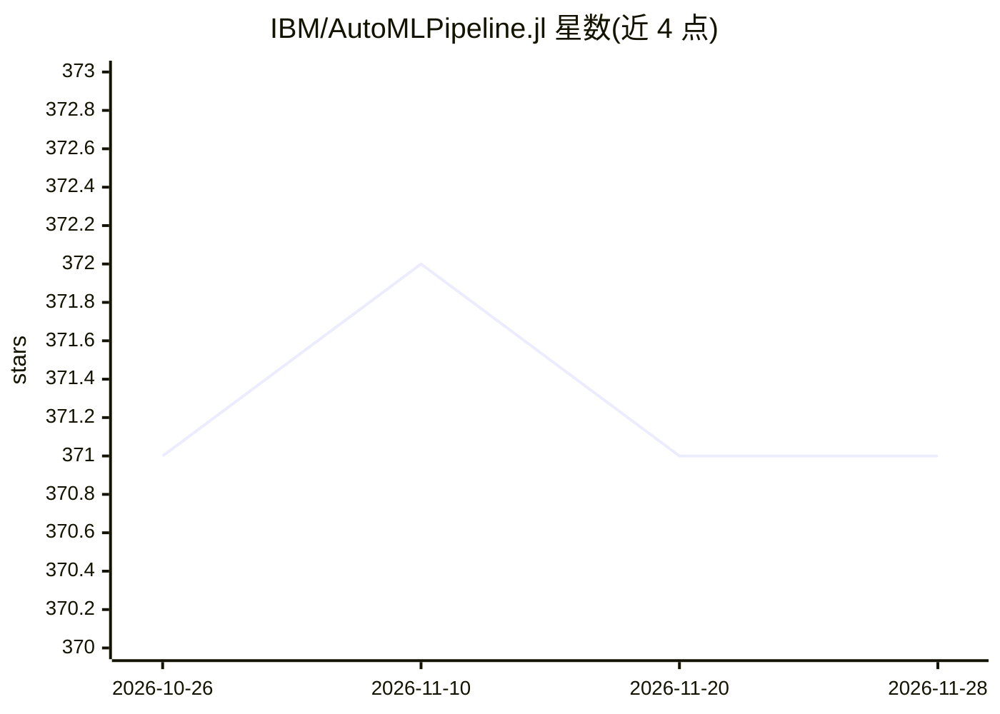

# IBM/AutoMLPipeline.jl

⭐ 371 · Julia · MIT · 推送 2026-11-21 · [GitHub](https://github.com/IBM/AutoMLPipeline.jl) · 组织维护

**Julia 机器学习流水线构建与评估库：组合特征处理与学习器**

基于 Julia 的 AutoML 流水线包：将特征选择器、预处理器（PCA/ICA/FA/多种 Scaler/OneHotEncoder）与学习器（随机森林、SVC、梯度提升、剪枝决策树、投票/堆叠集成、BestLearner）用 |> 管道操作符和 + 组合符串联成流水线，通过 fit_transform! 训练与预测，crossvalidate 支持按 sklearn 指标做交叉验证，并提供 @pipeline/@pipelinex 宏展开流水线表达式、Distributed 并行处理，另含异常检测扩展 AutoAD。面向 Julia 数据科学用户，安装通过 Julia Pkg（pkg> add AutoMLPipeline），并附论文链接与基准对比。

## 筛选速览

| 维度 | 判定 | 备注 |
|---|---|---|
| AI 角色 | `ai-native` | 本体是模型或模型工具 |
| 许可风险 | `permissive` | MIT |
| 部署形态 | `None` |  |
| 模型依赖 | — | README 未给出锁定关系 |
| 硬件要求 | — | 无带数字的原话,不猜 |
| 安装摩擦 | `low` | 无编译、无系统依赖或容器化 |
| 成熟度 | — | 结构信号不足 |

## 能力要点

- |> 与 + 组合符将特征处理与学习器串联为流水线
- crossvalidate 支持 sklearn 性能指标的交叉验证
- @pipeline 宏展开流水线表达式，支持 Distributed 并行
- skoperator() 接入 sklearn 风格算子，含集成学习器

## 适用场景

- 快速组合预处理与分类/回归学习器并交叉验证
- 对比多个学习器在数据集上的表现
- 并行评估多条流水线架构

## 场景标签

`MLOps` · 领域:训练与推理

## 证据(README 行号)

> L1: ## AutoMLPipeline
> L76: #### 2. Load Filters, Transformers, and Learners
> L102: rf = skoperator("RandomForestClassifier")

## 星数曲线

2026-10-26 371 → 2026-11-28 371（+0）

---
*卡片 v1 · prompt 1.4 · 生成 2026-11-25 · 置信度 high · 依据 README sha `be30126e4a50` · [字段定义](../../DATASET.md)*
