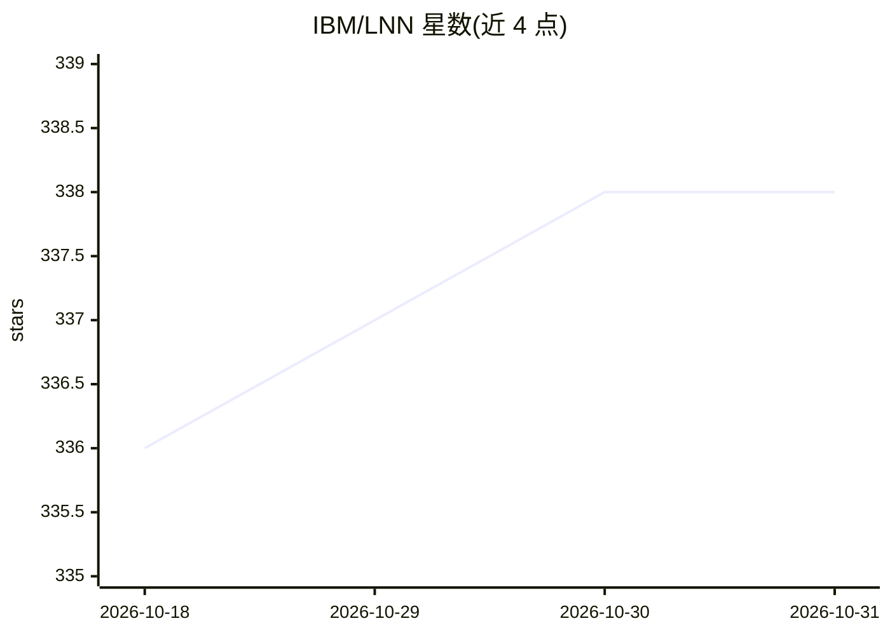

# IBM/LNN

⭐ 338 · Python · Apache-2.0 · 推送 2026-10-28 · [GitHub](https://github.com/IBM/LNN) · [官网](https://IBM.github.io/LNN/) · 组织维护

**神经=符号框架：可学习且可推理的加权实值逻辑网络**

IBM 维护的 Logical Neural Networks（LNN）开源框架，将神经网络的学习能力与符号逻辑的知识推理结合：每个神经元对应加权实值逻辑公式中的成分，推理是全向的，包含经典一阶逻辑定理证明作为特例；模型端到端可微，通过最小化捕捉逻辑矛盾的损失函数学习，并以真值上下界支持开放世界假设。提供 Python 库形式，要求 Python 3.11+，通过 git clone 与 uv 安装锁定环境，附文档、论文与教学资源。

## 筛选速览

| 维度 | 判定 | 备注 |
|---|---|---|
| AI 角色 | `ai-native` | 本体是模型或模型工具 |
| 许可风险 | `permissive` | Apache-2.0 |
| 部署形态 | `None` |  |
| 模型依赖 | — | README 未给出锁定关系 |
| 硬件要求 | — | 无带数字的原话,不猜 |
| 安装摩擦 | `low` | 无编译、无系统依赖或容器化 |
| 成熟度 | — | 结构信号不足 |

## 能力要点

- 每个神经元对应加权实值逻辑公式的成分，提供可解释表示
- 全向推理，包含经典一阶逻辑定理证明作为特例
- 端到端可微，损失函数捕捉逻辑矛盾
- 以真值上下界支持开放世界假设

## 适用场景

- 做神经符号 AI 的研究与实验
- 需要可解释且容忍不一致/不完整知识的推理建模
- 基于一阶逻辑与学习的混合系统原型开发

## 场景标签

 · 领域:机器学习/神经符号推理

## 证据(README 行号)

> L7: LNNs are a novel `Neuro = Symbolic` framework designed to seamlessly provide key
> L8: properties of both neural nets (learning) and symbolic logic (knowledge and reasoning).

## 星数曲线

2026-10-18 336 → 2026-10-31 338（+2）

---
*卡片 v1 · prompt 1.4 · 生成 2026-10-21 · 置信度 high · 依据 README sha `fe71e639413a` · [字段定义](../../DATASET.md)*
