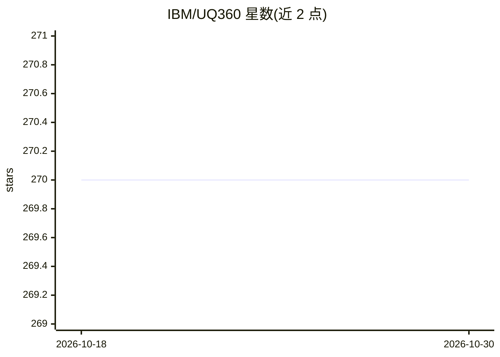

# IBM/UQ360

⭐ 270 · Python · Apache-2.0 · 推送 2026-09-16 · [GitHub](https://github.com/IBM/UQ360) · [官网](https://uq360.res.ibm.com/) · 组织维护

**面向数据科学家的机器学习不确定性量化 Python 工具包**

IBM 开源的 Python 工具包，为数据科学从业者与开发者提供机器学习预测的不确定性估计、评估、改进与沟通的算法和指标，作为 AI 透明性的常见实践。包含算法与指标清单、教程和示例 notebook，支持用 meta-model 为 sklearn 回归器附加预测区间、用 PICP 分数做交叉验证选型。包设计为可扩展，供社区贡献新的估计算法与指标。支持 macOS/Ubuntu/Windows（Python 3.7），可 pip 安装或源码安装。

## 筛选速览

| 维度 | 判定 | 备注 |
|---|---|---|
| AI 角色 | `ai-ecosystem` | LLM/agent 周边工具 |
| 许可风险 | `permissive` | Apache-2.0 |
| 部署形态 | `library` | 以包/库形式分发 |
| 模型依赖 | — | README 未给出锁定关系 |
| 硬件要求 | — | 无带数字的原话,不猜 |
| 安装摩擦 | `low` | 无编译、无系统依赖或容器化 |
| 成熟度 | `idea` | |

## 能力要点

- 提供不确定性估计算法与指标清单，支持选择算法/指标的指引
- meta-model 为 sklearn 梯度提升回归器附加预测区间
- PICP 等指标可用于交叉验证模型选择
- 教程、示例 notebook 与交互式入门体验

## 适用场景

- 为回归模型附加预测区间并评估覆盖率
- 在模型选择中使用不确定性指标做交叉验证
- 学习并实践不确定性量化的算法与沟通方式

## 场景标签

 · 领域:机器学习/可信 AI

## 证据(README 行号)

> L6: The Uncertainty Quantification 360 (UQ360) is an open-source toolkit with a Python package to provide data science
> L7: practitioners and developers access to state-of-the-art algorithms, to streamline the process of estimating, evaluat
> L8: improving, and communicating uncertainty of machine learning models as common practices for AI transparency.

## 星数曲线

2026-10-18 270 → 2026-10-30 270（+0）

---
*卡片 v1 · prompt 1.4 · 生成 2026-10-22 · 置信度 high · 依据 README sha `1e55af8d2447` · [字段定义](../../DATASET.md)*
