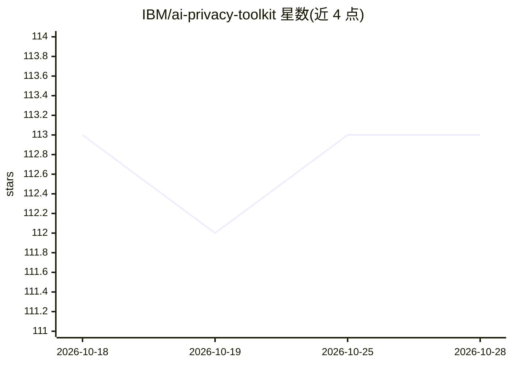

# IBM/ai-privacy-toolkit

⭐ 113 · Python · MIT · 推送 2026-09-19 · [GitHub](https://github.com/IBM/ai-privacy-toolkit) · [官网](https://aip360.res.ibm.com) · 组织维护

**AI 模型隐私合规工具包：训练数据匿名化与数据最小化**

IBM 维护的 Python 工具包，围绕 AI 模型的隐私与合规提供三个模块：anonymization 对 ML 训练数据做匿名化，使重训后的模型可被视为匿名从而可能豁免 GDPR/CCPA 等法规义务；minimization 通过移除或泛化输入特征，在保持预测精度的同时减少预测所需的个人数据量以符合 GDPR 数据最小化原则；dataset assessment 对用于模型训练的合成数据集做隐私评估。通过 pip 安装，附官方 readthedocs 文档与 SoftwareX 论文引用。

## 筛选速览

| 维度 | 判定 | 备注 |
|---|---|---|
| AI 角色 | `ai-ecosystem` | LLM/agent 周边工具 |
| 许可风险 | `permissive` | MIT |
| 部署形态 | `library` | 以包/库形式分发 |
| 模型依赖 | — | README 未给出锁定关系 |
| 硬件要求 | — | 无带数字的原话,不猜 |
| 安装摩擦 | `low` | 无编译、无系统依赖或容器化 |
| 成熟度 | — | 结构信号不足 |

## 能力要点

- 训练数据匿名化：模型重训后可被视为匿名
- 数据最小化：移除/泛化输入特征以减少预测所需个人数据
- 合成数据集隐私评估模块
- 面向 GDPR/CCPA 等数据保护法规的合规场景

## 适用场景

- 对 ML 训练数据匿名化以满足 GDPR/CCPA 义务豁免条件
- 在保持预测精度的前提下减少模型预测使用的个人数据
- 评估用于模型训练的合成数据集的隐私风险

## 场景标签

 · 领域:可信 AI/隐私工程

## 证据(README 行号)

> L5: A toolkit for tools and techniques related to the privacy and compliance of AI models.
> L7: The **anonymization** module contains methods for anonymizing ML model
> L12: The **minimization** module contains methods to help adhere to the data

## 星数曲线

2026-10-18 113 → 2026-10-28 113（+0）

---
*卡片 v1 · prompt 1.4 · 生成 2026-10-23 · 置信度 high · 依据 README sha `1a812622ff32` · [字段定义](../../DATASET.md)*
