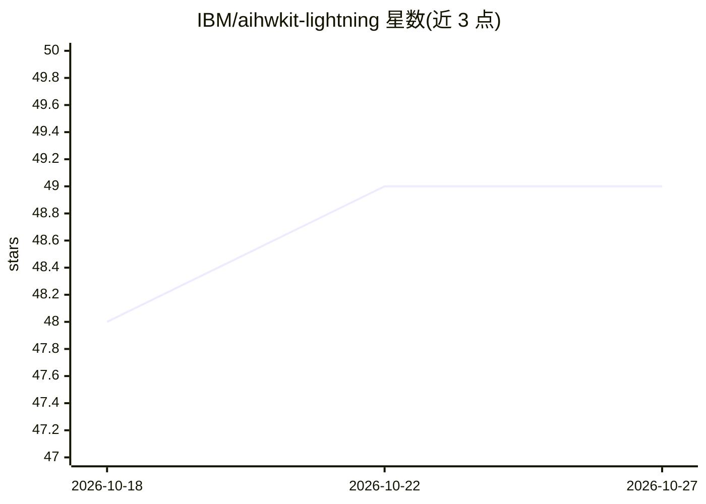

# IBM/aihwkit-lightning

⭐ 49 · Python · MIT · 推送 2026-10-26 · [GitHub](https://github.com/IBM/aihwkit-lightning) · [官网](https://aihwkit-lightning.readthedocs.io) · 组织维护

**面向模拟器的硬件感知训练工具包：在 AIMC 上训练大模型**

IBM Research 开发的工具包，用于在模拟的模拟存内计算（AIMC）硬件上高效训练大型语言模型与神经网络。核心机制：以 CUDA/Triton 内核模拟模拟硬件非理想性（噪声注入、DAC/ADC 量化、权重裁剪等），PyTorch 层的替换式（drop-in）集成，支持将训练好的模型导出到 AIHWKIT 做详细分析。README 声明已验证至 3.8B 参数模型；triton 模式标记为实验性，存在 torch.compile 与部分梯度不可用等限制。以 pip/git clone 源码方式安装，需搭配 PyTorch 生态。

## 筛选速览

| 维度 | 判定 | 备注 |
|---|---|---|
| AI 角色 | `ai-ecosystem` | LLM/agent 周边工具 |
| 许可风险 | `permissive` | MIT |
| 部署形态 | `library` | 以包/库形式分发 |
| 模型依赖 | — | README 未给出锁定关系 |
| 硬件要求 | — | 无带数字的原话,不猜 |
| 安装摩擦 | `high` | 编译与系统依赖俱全 |
| 成熟度 | `idea` | |

## 能力要点

- 模拟 AIMC 硬件非理想性：噪声注入、输入/输出量化、权重裁剪
- PyTorch 层替换式集成，提供 CUDA/Triton 内核
- 支持模型导出到 AIHWKIT 做详细分析与推理仿真
- 示例覆盖 HuggingFace、DeepSpeed、Slurm 多节点训练

## 适用场景

- 在模拟模拟硬件上研究硬件感知的大模型训练
- 将 Lightning 训练的模型导出到 AIHWKIT 做推理仿真
- 多节点扩展训练十亿参数级模型

## 场景标签

`模型训练` · 领域:训练与推理

## 证据(README 行号)

> L10: AIHWKIT-Lightning is a streamlined, performance-optimized toolkit designed for efficient hardware-aware training of
> L21: - **🔧 Easy Integration**: Drop-in replacement for PyTorch layers with minimal code changes

## 星数曲线

2026-10-18 48 → 2026-10-27 49（+1）

---
*卡片 v1 · prompt 1.4 · 生成 2026-10-25 · 置信度 high · 依据 README sha `9f48c2ae3738` · [字段定义](../../DATASET.md)*
