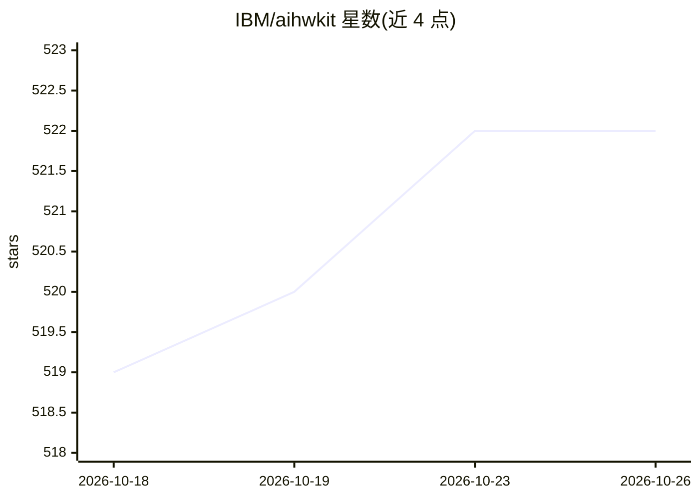

# IBM/aihwkit

⭐ 522 · Jupyter Notebook · MIT · 推送 2026-10-22 · [GitHub](https://github.com/IBM/aihwkit) · [官网](https://aihwkit.readthedocs.io) · 组织维护

**面向研究者的模拟内存计算（AIMC）硬件模拟与硬件感知训练 PyTorch 工具包**

IBM Research 开发的 Python 工具包，包含两部分：PyTorch 集成（模拟版全连接/卷积/LSTM 层、模拟 SGD 优化器、in-situ 训练算法如 Tiki-Taka、基于百万 PCM 器件芯片测量校准的统计模型、硬件感知训练），以及 CUDA/ROCm(HIP) C++ 模拟器，可模拟多种模拟器件与交叉阵列配置（噪声、ADC/DAC 量化、器件波动等）。另提供经硬件校准的器件预设库、实验模块、预训练模型自动转模拟层工具及 AIHW Composer 云平台集成。安装支持 pip、conda（CPU/GPU）、Docker 与源码编译（cmake）。库自述处于 beta 阶段。

## 筛选速览

| 维度 | 判定 | 备注 |
|---|---|---|
| AI 角色 | `ai-ecosystem` | LLM/agent 周边工具 |
| 许可风险 | `permissive` | MIT |
| 部署形态 | `self-host` | docker 或自建部署 |
| 模型依赖 | — | README 未给出锁定关系 |
| 硬件要求 | — | 无带数字的原话,不猜 |
| 安装摩擦 | `low` | 无编译、无系统依赖或容器化 |
| 成熟度 | `idea` | |

## 能力要点

- 基于 100 万 PCM 器件芯片测量校准的相变存储阵列统计模型
- CUDA 与 ROCm/HIP 双后端的 C++ 模拟器件/交叉阵列模拟器
- 模拟版 PyTorch 层与优化器，支持硬件感知训练
- 经硬件数据校准的器件预设库与预训练模型自动转模拟层工具

## 适用场景

- 研究模拟内存计算硬件上训练/推理神经网络的行为
- 做硬件感知训练以提升模型在模拟硬件上推理的鲁棒性
- 探索不同材料器件参数规格对训练与推理的影响

## 场景标签

`模型训练` · 领域:训练与推理

## 证据(README 行号)

> L18: _IBM Analog Hardware Acceleration Kit_ is an open source Python toolkit for
> L19: exploring and using the capabilities of in-memory computing devices in the
> L48: A high-performant (CUDA-capable) C++ simulator that allows for

## 星数曲线

2026-10-18 519 → 2026-10-26 522（+3）

---
*卡片 v1 · prompt 1.4 · 生成 2026-10-21 · 置信度 high · 依据 README sha `4cf5cfced0e4` · [字段定义](../../DATASET.md)*
