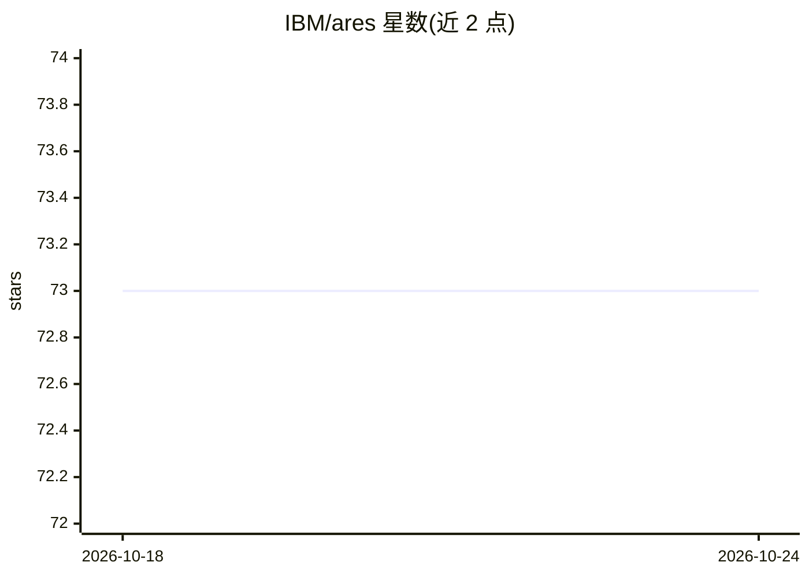

# IBM/ares

⭐ 73 · Python · Apache-2.0 · 推送 2026-10-24 · [GitHub](https://github.com/IBM/ares) · [官网](https://ibm.github.io/ares/) · 组织维护

**面向研究与企业安全团队的 LLM 红队/鲁棒性评测编排框架**

IBM 维护的 LLM 安全评测编排框架：通过 YAML 配置或 Python API 组合目标模型、攻击目标（PII 泄露、提示注入、越狱）、攻击策略（含 Garak、PyRIT、AutoDAN 等 19 个内置插件）与评估器（关键词、LLM 裁判），输出统一报告与聊天式攻击可视化。面向想基准测试新攻击方法的研究者、按 OWASP top-10 做部署前审计的安全团队，以及需要接入自定义防护与评估器的开发者。提供 CLI、GUI 和插件目录机制，支持本地模型与云端 API 多模型测试。

## 筛选速览

| 维度 | 判定 | 备注 |
|---|---|---|
| AI 角色 | `ai-ecosystem` | LLM/agent 周边工具 |
| 许可风险 | `permissive` | Apache-2.0 |
| 部署形态 | `library` | 以包/库形式分发 |
| 模型依赖 | — | README 未给出锁定关系 |
| 硬件要求 | — | 无带数字的原话,不猜 |
| 安装摩擦 | `low` | 无编译、无系统依赖或容器化 |
| 成熟度 | — | 结构信号不足 |

## 能力要点

- YAML 配置驱动与 Python API 两种编排方式
- 19 个内置插件（Garak、PyRIT、AutoDAN、CyberSecEval 等），支持自定义攻击/评估器/防护
- 覆盖单轮与多轮攻击，结果以聊天式对话与 HTML 报告呈现
- 提供无代码 GUI 与 CI/CD 集成路径

## 适用场景

- 模型上线前按 OWASP top-10 做安全审计
- 把自己的新攻击方法与 20+ 已有方法做基准对比
- 测试 Granite Guardian 等防护栏对各类攻击的拦截效果

## 场景标签

`模型评测` `网络安全` · 领域:评测与运维

## 证据(README 行号)

> L23: **What is ARES?** An orchestration framework that lets you plug in your own attacks, evaluators, and guardrails to 
> L59: The ARES programming model provides a flexible framework for orchestrating robustness evaluations:
> L64: - **Plugin Catalog**: Extensible collection of target connectors, attack goals, strategies, and evaluations

## 星数曲线

2026-10-18 73 → 2026-10-24 73（+0）

---
*卡片 v1 · prompt 1.4 · 生成 2026-10-24 · 置信度 high · 依据 README sha `9690478d5356` · [字段定义](../../DATASET.md)*
