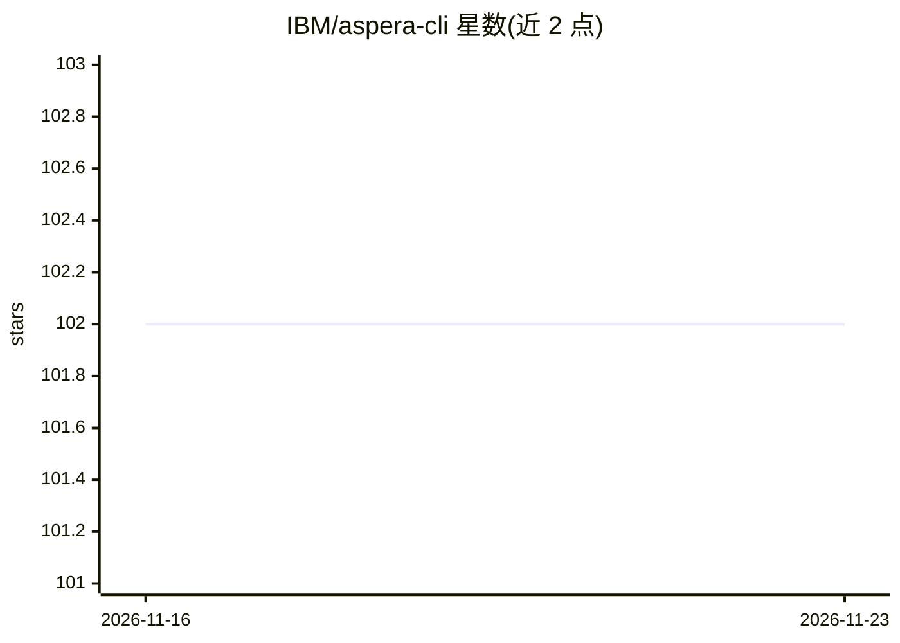

# IBM/aspera-cli

⭐ 102 · Ruby · Apache-2.0 · 推送 2026-11-22 · [GitHub](https://github.com/IBM/aspera-cli) · [官网](https://ibm.github.io/aspera-cli/) · 组织维护

**IBM Aspera 传输产品的命令行工具与 MCP 服务器**

IBM Aspera 的官方命令行接口 ascli，从终端或脚本驱动 Aspera on Cloud、Faspex、Shares、Node、Console、Orchestrator 与高速传输服务器（HSTS），调用 REST API 并执行 FASP 高速文件传输，支持配置、预设与脚本化工作流。同时内建 MCP server（ascli mcp server），可将全部命令暴露给 AI 客户端并施加权限限制、不向 AI 展示密钥；也可通过 llms.txt 或 agent skill 供编码代理直接发现命令用法。以 Ruby gem 形式安装，需 Ruby ≥ 3.3，第二条命令安装 FASP 传输引擎 ascp。

## 筛选速览

| 维度 | 判定 | 备注 |
|---|---|---|
| AI 角色 | `ai-enhanced` | 去掉 AI 部分产品仍成立 |
| 许可风险 | `permissive` | Apache-2.0 |
| 部署形态 | `None` |  |
| 模型依赖 | — | README 未给出锁定关系 |
| 硬件要求 | — | 无带数字的原话,不猜 |
| 安装摩擦 | `low` | 无编译、无系统依赖或容器化 |
| 成熟度 | — | 结构信号不足 |

## 能力要点

- 驱动 7 类 IBM Aspera 产品的统一 CLI
- FASP 高速传输引擎（ascp）安装与调用
- 内建 MCP server：暴露命令给 AI 客户端，带权限限制且不向 AI 显示密钥
- 提供 llms.txt 与 agent skill 供编码代理自发现命令用法

## 适用场景

- 在终端或脚本中自动化 IBM Aspera 产品操作与文件传输
- 让 AI 助手或 agent 通过 MCP 操作 Aspera 传输
- 把 Aspera 工作流接入编码代理的 shell 环境

## 场景标签

 · 领域:文件传输/企业基础设施

## 证据(README 行号)

> L11: **`ascli`** is the command-line interface for IBM Aspera products.
> L20: `ascli` is built to be used by AI assistants and AI agents (LLM), so that they can operate IBM Aspera products (Asp

## 星数曲线

2026-11-16 102 → 2026-11-23 102（+0）

---
*卡片 v1 · prompt 1.4 · 生成 2026-11-17 · 置信度 high · 依据 README sha `6e584e884c7d` · [字段定义](../../DATASET.md)*
