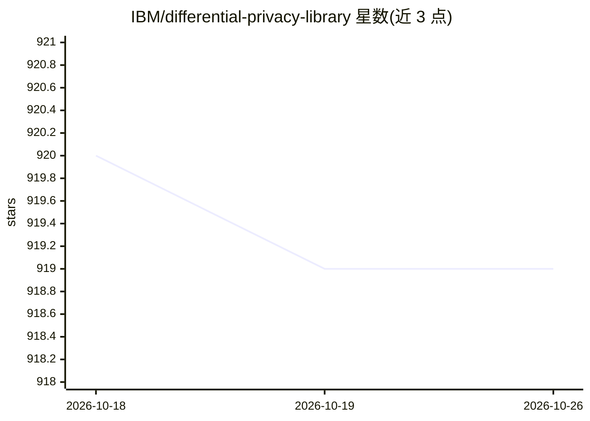

# IBM/differential-privacy-library

⭐ 919 · Python · MIT · 推送 2026-10-12 · [GitHub](https://github.com/IBM/differential-privacy-library) · [官网](https://diffprivlib.readthedocs.io) · 组织维护

**差分隐私通用 Python 库：含 sklearn 风格的隐私保护机器学习**

IBM 维护的通用差分隐私库，面向希望实验差分隐私、研究其对机器学习与数据分析影响、或原型化自有差分隐私算法的研究者与工程师。提供与 sklearn 分类器接口一致的差分隐私模型（如 GaussianNB），隐私级别由 epsilon 参数控制，每次 .fit() 因随机性产生不同模型。通过 pip 安装，附单元测试与示例 notebook。README 声明公开发布版本仅面向研究与教育用途，生产使用需联系维护方。

## 筛选速览

| 维度 | 判定 | 备注 |
|---|---|---|
| AI 角色 | `ai-native` | 本体是模型或模型工具 |
| 许可风险 | `permissive` | MIT |
| 部署形态 | `library` | 以包/库形式分发 |
| 模型依赖 | — | README 未给出锁定关系 |
| 硬件要求 | — | 无带数字的原话,不猜 |
| 安装摩擦 | `low` | 无编译、无系统依赖或容器化 |
| 成熟度 | — | 结构信号不足 |

## 能力要点

- 提供 sklearn 接口一致的差分隐私机器学习模型
- epsilon 参数控制隐私级别（默认 1.0）
- 含差分隐私机制与工具模块，支持原型化自有 DP 算法
- 配套示例 notebook 与 pytest 单元测试

## 适用场景

- 在 sklearn 工作流中训练差分隐私模型
- 实验不同 epsilon 值下隐私与精度的权衡
- 原型化并验证自己的差分隐私算法

## 场景标签

 · 领域:隐私计算/机器学习

## 证据(README 行号)

> L12: Diffprivlib is a general-purpose library for differential privacy (DP). Use diffprivlib if you are looking to:
> L33: Now, let's train a differentially private naive Bayes classifier. Our classifier __runs just like an `sklearn` clas

## 星数曲线

2026-10-18 920 → 2026-10-26 919（-1）

---
*卡片 v1 · prompt 1.4 · 生成 2026-10-21 · 置信度 high · 依据 README sha `204839284d7c` · [字段定义](../../DATASET.md)*
