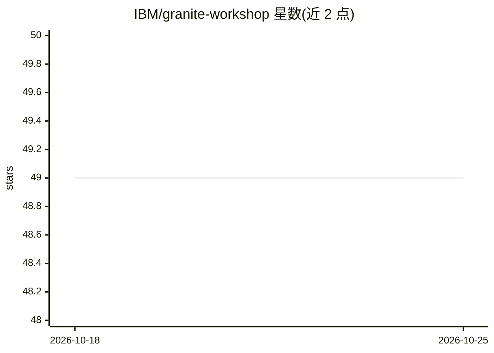

# IBM/granite-workshop

⭐ 49 · Jupyter Notebook · Apache-2.0 · 推送 2026-10-22 · [GitHub](https://github.com/IBM/granite-workshop) · [官网](https://ibm.github.io/granite-workshop/) · 组织维护

**IBM Granite 基础模型 AI 研讨会教程站（GitHub Pages）**

IBM Granite 基础模型 AI 研讨会的源码仓库，使用 Material for MkDocs 构建，托管于 GitHub Pages 提供在线浏览，内容主题涵盖提示工程、RAG、文本摘要与时间序列预测（据仓库主题标签）。README 本身仅说明站点地址与许可信息，具体教程内容需访问在线站点或源码目录。面向参与 Granite 模型学习和实践的开发者与学习者。

## 筛选速览

| 维度 | 判定 | 备注 |
|---|---|---|
| AI 角色 | `ai-knowledge` | 知识聚合/清单类 |
| 许可风险 | `permissive` | Apache-2.0 |
| 部署形态 | `None` |  |
| 模型依赖 | — | README 未给出锁定关系 |
| 硬件要求 | — | 无带数字的原话,不猜 |
| 安装摩擦 | `low` | 无编译、无系统依赖或容器化 |
| 成熟度 | — | 结构信号不足 |

## 能力要点

- 基于 Material for MkDocs 构建并托管于 GitHub Pages
- 主题覆盖提示工程、RAG、文本摘要、时间序列预测
- 由 IBM 维护的 Granite 模型官方研讨会材料

## 适用场景

- 学习 IBM Granite 基础模型的提示工程与 RAG 实践
- 跟随研讨会材料进行文本摘要与时间序列预测实验
- 作为 Granite 模型应用的教程参考

## 场景标签

`教程课程` · 领域:学习与行业

## 证据(README 行号)

> L1: # Granite Foundation Models AI Workshop
> L3: This is the Granite foundation models AI workshop hosted on GitHub Pages using Material for MkDocs. To view it onlin

## 星数曲线

2026-10-18 49 → 2026-10-25 49（+0）

---
*卡片 v1 · prompt 1.4 · 生成 2026-10-25 · 置信度 mid · 依据 README sha `4fdf9a984119` · [字段定义](../../DATASET.md)*
