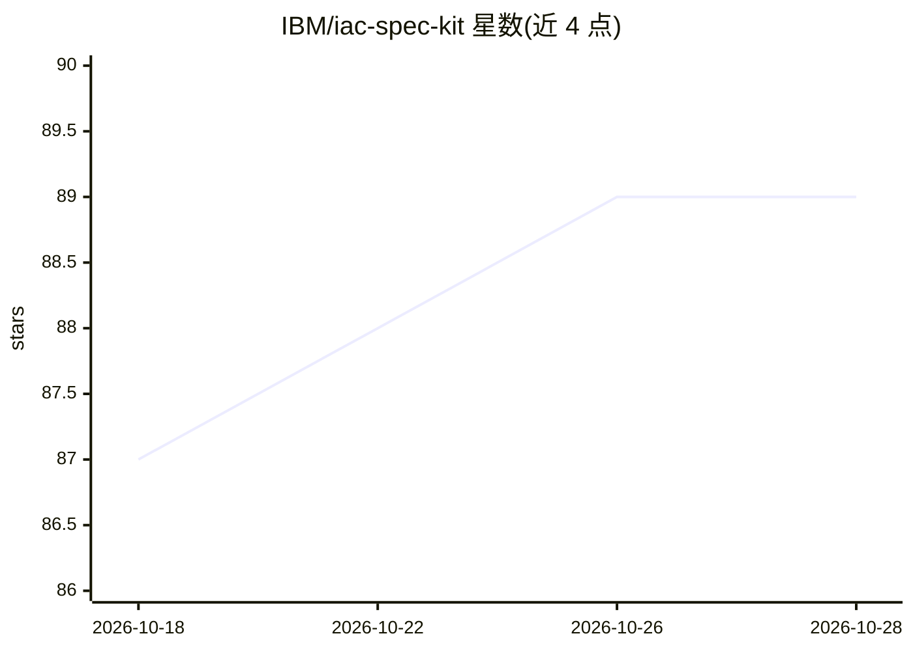

# IBM/iac-spec-kit

⭐ 89 · Python · MIT · 推送 2026-10-28 · [GitHub](https://github.com/IBM/iac-spec-kit) · 组织维护

**面向基础设施即代码的规格驱动开发工具包：用 AI 助手把需求转为 IaC 代码**

基于 GitHub Spec Kit 的 IaC 专用实现，实践规格驱动开发（SDD）：先写规格文档，再由 AI 助手经 `/iac.specify`、`/iac.plan`、`/iac.tasks`、`/iac.implement` 等斜杠命令生成实施计划与 Terraform 代码。面向云基础设施开发团队，要求区分通用需求与云特定实现，支持 AWS/Azure/GCP/IBM Cloud 等多云切换；通过 uv 安装 iac-specify CLI 初始化项目，需配合 Claude Code、Cursor 等 AI 编码工具与 MCP 服务器使用。项目自称实验性探索。

## 筛选速览

| 维度 | 判定 | 备注 |
|---|---|---|
| AI 角色 | `ai-ecosystem` | LLM/agent 周边工具 |
| 许可风险 | `permissive` | MIT |
| 部署形态 | `None` |  |
| 模型依赖 | — | README 未给出锁定关系 |
| 硬件要求 | — | 无带数字的原话,不猜 |
| 安装摩擦 | `low` | 无编译、无系统依赖或容器化 |
| 成熟度 | — | 结构信号不足 |

## 能力要点

- `.iac.*` 斜杠命令集（specify/plan/tasks/implement/principles/enrichplan）
- 规格与云实现分离，同一规格可经 `/iac.plan` 切换多云部署
- 提供多云示例工作流（VPC、WordPress、三层 Web 应用等）
- 建议配置 Terraform/云厂商 MCP 服务器以减少幻觉

## 适用场景

- 把业务需求经 AI 助手逐级转为规格、计划与 Terraform 代码
- 同一基础设施规格在多个云厂商间比较与迁移
- 团队以可评审的规格文档对齐基础设施需求

## 场景标签

`编码 Agent` `代码生成` · 领域:编码与开发

## 证据(README 行号)

> L30: **IaC Spec Kit** is a specialized implementation of the GitHub Spec Kit toolkit, adapted for Infrastructure as Code
> L44: - **Infrastructure command namespace**: All commands use `.iac` prefix (`/iac.principles`, `/iac.specify`, `/iac.pl
> L127: Launch your AI assistant in the project directory. The `/iac.*` commands are available in the assistant.

## 星数曲线

2026-10-18 87 → 2026-10-28 89（+2）

---
*卡片 v1 · prompt 1.4 · 生成 2026-10-23 · 置信度 high · 依据 README sha `5d0047d2aa68` · [字段定义](../../DATASET.md)*
