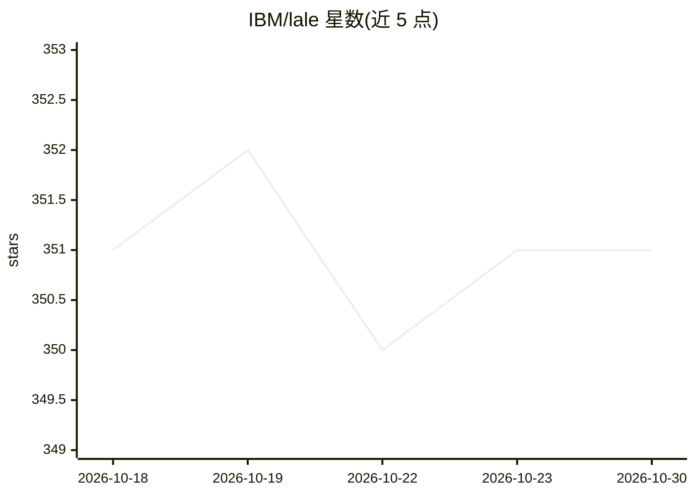

# IBM/lale

⭐ 351 · Python · Apache-2.0 · 推送 2026-09-29 · [GitHub](https://github.com/IBM/lale) · [官网](https://lale.readthedocs.io) · 组织维护 · 中文 README

**面向数据科学家的半自动机器学习 Python 库**

IBM 维护的 Python 库，为兼容 scikit-learn 的流水线提供算法自动选择与超参数调优，覆盖三个方向：自动化（统一接口接入 Hyperopt、GridSearchCV、SMAC 等搜索工具）、正确性检查（用 JSON Schema 检查超参数类型与数据-算子不匹配）、互操作性（封装 scikit-learn、XGBoost、PyTorch 等库的转换器与估计器）。以普通 Python 包形式安装，可在 Jupyter 中使用。当前为 Alpha 发布阶段，不附带任何保证。

## 筛选速览

| 维度 | 判定 | 备注 |
|---|---|---|
| AI 角色 | `ai-ecosystem` | LLM/agent 周边工具 |
| 许可风险 | `permissive` | Apache-2.0 |
| 部署形态 | `library` | 以包/库形式分发 |
| 模型依赖 | — | README 未给出锁定关系 |
| 硬件要求 | — | 无带数字的原话,不猜 |
| 安装摩擦 | `low` | 无编译、无系统依赖或容器化 |
| 成熟度 | `idea` | |

## 能力要点

- 统一高层接口接入 Hyperopt / GridSearchCV / SMAC 流水线搜索
- 基于 JSON Schema 的超参数与数据类型错误检查
- 封装 scikit-learn、XGBoost、PyTorch 等库的算子库
- 无需安装新工具或学习新语法，兼容 scikit-learn 使用习惯

## 适用场景

- 我想自动为 scikit-learn 流水线选算法并调超参数
- 我在实验 AutoML，希望有类型安全的流水线组装检查
- 我希望在 XGBoost、PyTorch 等不同库的算子间组合流水线

## 场景标签

`MLOps` · 领域:训练与推理

## 证据(README 行号)

> L22: Lale is a Python library for semi-automated data science.
> L30: For *automation*, Lale provides a consistent high-level interface to

## 星数曲线

2026-10-18 351 → 2026-10-30 351（+0）

---
*卡片 v1 · prompt 1.4 · 生成 2026-10-21 · 置信度 high · 依据 README sha `7aec46defab7` · [字段定义](../../DATASET.md)*
