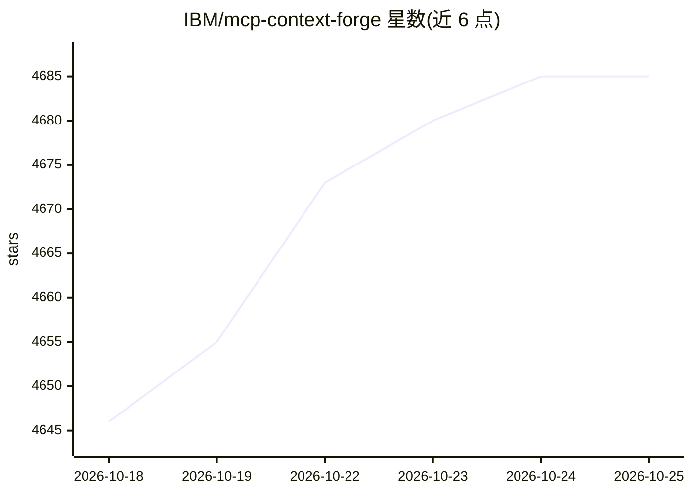

# IBM/mcp-context-forge

⭐ 4,687 · Python · Apache-2.0 · 推送 2026-10-24 · [GitHub](https://github.com/IBM/mcp-context-forge) · [官网](https://ibm.github.io/mcp-context-forge/) · 组织维护

**IBM 开源的 MCP/A2A/REST 联邦网关与注册中心**

ContextForge 是开源的 AI 网关、注册中心与代理，将 MCP 服务器、A2A 服务及 REST/gRPC API 联邦为统一端点，提供集中治理、服务发现、鉴权、限流、重试与 OpenTelemetry 可观测性。作为完全合规的 MCP 服务器运行，支持 gRPC/REST-to-MCP 转换、40+ 插件扩展、Admin UI，可通过 PyPI、Docker/Podman 或 Helm 部署，Redis 支持多集群联邦。运行需强制配置 JWT_SECRET_KEY 与 AUTH_ENCRYPTION_SECRET；arm64 容器生产环境暂不支持。

## 筛选速览

| 维度 | 判定 | 备注 |
|---|---|---|
| AI 角色 | `ai-ecosystem` | LLM/agent 周边工具 |
| 许可风险 | `permissive` | Apache-2.0 |
| 部署形态 | `self-host` | docker 或自建部署 |
| 模型依赖 | — | README 未给出锁定关系 |
| 硬件要求 | — | 无带数字的原话,不猜 |
| 安装摩擦 | `low` | 无编译、无系统依赖或容器化 |
| 成熟度 | — | 结构信号不足 |

## 能力要点

- MCP、A2A、REST/gRPC 统一为单一端点，含协议转换
- 内置鉴权（Basic/JWT/OAuth）、限流、重试与反向代理
- 40+ 插件与 OpenTelemetry 追踪（Phoenix/Jaeger/Zipkin 等）
- 提供 Admin UI、Docker/PyPI/Helm 多种部署方式

## 适用场景

- 把多个 MCP 服务器和 REST API 聚合成一个端点给 AI 客户端调用
- 对 Agent 与工具调用做集中鉴权、限流与可观测
- 在 Kubernetes 上做多集群联邦部署

## 场景标签

`模型网关` · 领域:Agent 开发

## 证据(README 行号)

> L17: **ContextForge** is an open source registry and proxy that federates tools, agents, and APIs into one clean endpoin
> L19: - **Tools Gateway** — MCP, REST, gRPC-to-MCP translation, and TOON compression
> L25: It runs as a fully compliant MCP server, deployable via PyPI or Docker, and scales to multi-cluster environments on

## 星数曲线

2026-10-18 4,646 → 2026-10-25 4,685（+39）

---
*卡片 v1 · prompt 1.4 · 生成 2026-10-20 · 置信度 high · 依据 README sha `b2efa1501588` · [字段定义](../../DATASET.md)*
