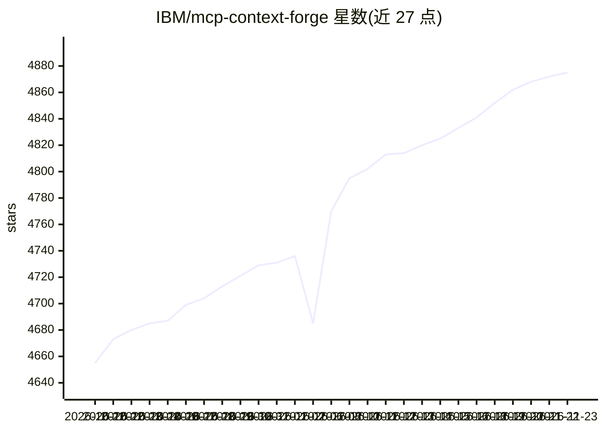

# IBM/mcp-context-forge

⭐ 4,875 · Python · Apache-2.0 · 推送 2026-11-21 · [GitHub](https://github.com/IBM/mcp-context-forge) · [官网](https://ibm.github.io/mcp-context-forge/) · 组织维护

**面向 AI 基础设施的 MCP/A2A/REST API 统一网关与注册中心**

IBM 开源的注册中心与代理，将 MCP 服务器、A2A 服务与 REST/gRPC API 聚合为统一端点，提供集中式治理、发现与可观测性。核心机制包括 gRPC 到 MCP 的反射式翻译、REST API 虚拟化为 MCP 工具、内置认证/重试/限流、OpenTelemetry 追踪（Phoenix/Jaeger/Zipkin 等后端）以及 40+ 插件扩展。通过 PyPI、Docker/Podman、Helm 部署，支持 Kubernetes 多集群联邦与 Redis 缓存；需配置 JWT_SECRET_KEY 与 AUTH_ENCRYPTION_SECRET 方可启动，arm64 生产环境暂不支持容器部署。

## 筛选速览

| 维度 | 判定 | 备注 |
|---|---|---|
| AI 角色 | `ai-ecosystem` | LLM/agent 周边工具 |
| 许可风险 | `permissive` | Apache-2.0 |
| 部署形态 | `self-host` | docker 或自建部署 |
| 模型依赖 | — | README 未给出锁定关系 |
| 硬件要求 | — | 无带数字的原话,不猜 |
| 安装摩擦 | `low` | 无编译、无系统依赖或容器化 |
| 成熟度 | — | 结构信号不足 |

## 能力要点

- 将 MCP、A2A、REST/gRPC API 联邦为单一统一端点
- gRPC-to-MCP 反射式翻译与 REST 工具适配（JSON Schema 自动提取）
- OpenTelemetry 可观测性，含 token 用量与成本指标
- 40+ 插件、Admin UI 与独立 Web UI

## 适用场景

- 为多个 MCP 服务器与 Agent 提供统一接入与治理端点
- 将遗留 REST/gRPC 服务封装为 MCP 工具供 AI 客户端调用
- 企业内集中管理工具注册、限流、认证与追踪

## 场景标签

`模型网关` `LLM 可观测性` · 领域:Agent 开发

## 证据(README 行号)

> L17: **ContextForge** is an open source registry and proxy that federates tools, agents, and APIs into one clean endpoin
> L19: - **Tools Gateway** — MCP, REST, gRPC-to-MCP translation, and TOON compression
> L43: **ContextForge** is an open source registry and proxy that federates any Model Context Protocol (MCP) server, A2A s

## 星数曲线

2026-10-21 4,655 → 2026-11-23 4,875（+220）

---
*卡片 v1 · prompt 1.4 · 生成 2026-11-22 · 置信度 high · 依据 README sha `e32b335588c6` · [字段定义](../../DATASET.md)*
