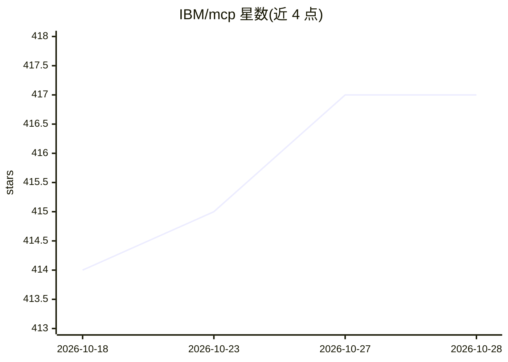

# IBM/mcp

⭐ 417 · Apache-2.0 · 推送 2026-10-01 · [GitHub](https://github.com/IBM/mcp) · [官网](https://www.ibm.com/think/topics/model-context-protocol) · 组织维护

**IBM 维护的 MCP 服务器与开发者工具集合，连接 IBM 产品与 AI Agent**

IBM 官方维护的 Model Context Protocol 资源集合，收录数十个 MCP 服务器，覆盖自动化、业务流程、数据分析、基础设施、可观测性、安全与生物医学研究等领域，将 IBM MQ、watsonx.data、IBM Cloud、QRadar、Guardium 等产品能力通过标准化协议暴露给 AI Agent。另列 BeeAI Framework、ContextForge MCP Gateway、Langflow 等开发者工具。各服务器为独立安装，README 未给出统一安装命令。

## 筛选速览

| 维度 | 判定 | 备注 |
|---|---|---|
| AI 角色 | `ai-ecosystem` | LLM/agent 周边工具 |
| 许可风险 | `permissive` | Apache-2.0 |
| 部署形态 | `None` |  |
| 模型依赖 | — | README 未给出锁定关系 |
| 硬件要求 | — | 无带数字的原话,不猜 |
| 安装摩擦 | `low` | 无编译、无系统依赖或容器化 |
| 成熟度 | — | 结构信号不足 |

## 能力要点

- 按自动化、数据、基础设施、安全等类别组织的数十个 IBM MCP 服务器
- 连接对象覆盖 IBM MQ、watsonx.data、IBM Cloud、QRadar SIEM、Guardium 等产品
- 包含 MAMMAL 生物医学基础模型的 MCP 服务器（蛋白相互作用、药物-蛋白相互作用等任务）
- 收录 BeeAI Framework、MCP Gateway、Langflow 等开发者工具

## 适用场景

- 让 AI Agent 通过 MCP 访问与操作 IBM 企业产品
- 为 VS Code 等 MCP 客户端安装特定 IBM 服务器的工具集
- 查找将现有 API 转为 MCP 工具的网关与代理方案

## 场景标签

`Agent 框架` · 领域:Agent 开发

## 证据(README 行号)

> L3: A collection of Model Context Protocol (MCP) servers, MCP Clients and Developer Tools by IBM. Connect your IBM produ
> L7: MCP is an open-source protocol designed to enable AI models to securely interact with local and remote resources thr
> L94: - BeeAI Framework - BeeAI Framework is an open-source framework for building production-grade multi-agent systems, 

## 星数曲线

2026-10-18 414 → 2026-10-28 417（+3）

---
*卡片 v1 · prompt 1.4 · 生成 2026-10-22 · 置信度 high · 依据 README sha `8b5f7e46639c` · [字段定义](../../DATASET.md)*
