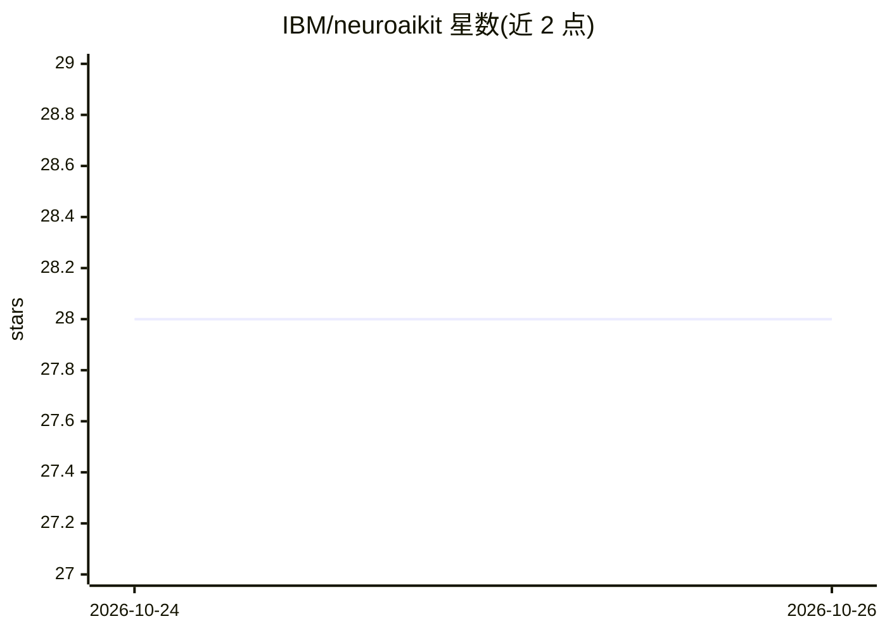

# IBM/neuroaikit

⭐ 28 · Jupyter Notebook · Apache-2.0 · 推送 2026-10-23 · [GitHub](https://github.com/IBM/neuroaikit) · 组织维护

**面向生物学启发 AI 的 SNN 工具库：构建 SNU 神经网络**

IBM 维护的 TensorFlow 2.x 生物启发 AI 工具库，用于构建基于 SNU（Synaptic Neuron Unit）的脉冲神经网络，支持 TensorFlow 或 PyTorch 作为后端。安装方式为 git clone 后 pip 可编辑安装，依赖（TensorFlow/PyTorch、Pandas、Matplotlib 等）需手动安装。关联论文发表于 Nature Machine Intelligence (2020)，TensorFlow 1.x 版本代码作为论文补充材料提供。

## 筛选速览

| 维度 | 判定 | 备注 |
|---|---|---|
| AI 角色 | `ai-native` | 本体是模型或模型工具 |
| 许可风险 | `permissive` | Apache-2.0 |
| 部署形态 | `library` | 以包/库形式分发 |
| 模型依赖 | — | README 未给出锁定关系 |
| 硬件要求 | — | 无带数字的原话,不猜 |
| 安装摩擦 | `low` | 无编译、无系统依赖或容器化 |
| 成熟度 | — | 结构信号不足 |

## 能力要点

- 在 TensorFlow 2.x 中构建 SNU 网络的生物启发 AI 工具库
- 支持 TensorFlow 或 PyTorch 后端
- 关联 Nat Mach Intell 论文（SNU 与存内计算）
- 提供 NER 示例（依赖 Datasets 包）

## 适用场景

- 用生物启发神经动力学构建深度学习模型
- 研究中模拟 SNU 脉冲神经元网络
- 复现论文中的生物启发学习实验

## 场景标签

`模型训练` · 领域:训练与推理

## 证据(README 行号)

> L5: This toolkit facilitates use of biologically-inspired AI in TensorFlow 2.x.
> L6: It enables to build SNU-based networks. For more deatail,

## 星数曲线

2026-10-24 28 → 2026-10-26 28（+0）

---
*卡片 v1 · prompt 1.4 · 生成 2026-10-26 · 置信度 mid · 依据 README sha `0d7515dbbded` · [字段定义](../../DATASET.md)*
