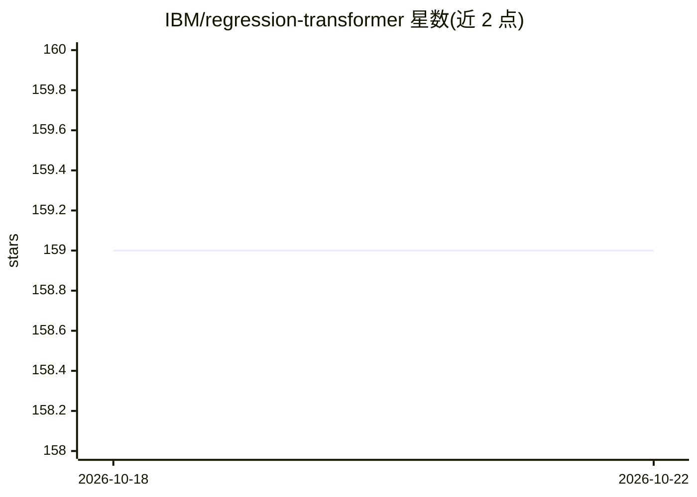

# IBM/regression-transformer

⭐ 159 · Python · MIT · 推送 2026-09-10 · [GitHub](https://github.com/IBM/regression-transformer) · [官网](https://www.nature.com/articles/s42256-023-00639-z) · 组织维护

**将回归任务化为条件序列建模的多任务 Transformer 模型实现**

Regression Transformer 的官方开发代码库：把回归（属性预测）与基于属性驱动的条件生成统一为条件序列建模任务，适用于分子、蛋白质、化学反应与聚合物等序列语言建模。提供基于 GT4SD 的预训练模型推理与微调路径（9 个预训练模型，涵盖小分子 QED/ESOL/logP、蛋白质稳定性、USPO 反应、聚合物催化剂等），以及通过 conda 环境复现论文结果的训练、评测脚本与数据集下载链接。论文发表于 Nature Machine Intelligence，另在 HuggingFace Spaces 提供 Gradio 演示。

## 筛选速览

| 维度 | 判定 | 备注 |
|---|---|---|
| AI 角色 | `ai-native` | 本体是模型或模型工具 |
| 许可风险 | `permissive` | MIT |
| 部署形态 | `library` | 以包/库形式分发 |
| 模型依赖 | — | README 未给出锁定关系 |
| 硬件要求 | — | 无带数字的原话,不猜 |
| 安装摩擦 | `low` | 无编译、无系统依赖或容器化 |
| 成熟度 | — | 结构信号不足 |

## 能力要点

- 回归与条件生成统一为多任务序列建模
- 经 GT4SD 提供 9 个预训练模型（小分子/蛋白质/反应/聚合物）
- 提供训练、评测、词表生成等开发脚本
- HuggingFace Spaces 上的 Gradio 演示

## 适用场景

- 在自定义数据上微调或从头训练分子语言模型
- 按目标属性条件生成分子的局部化学空间
- 复现 Nature Machine Intelligence 论文结果

## 场景标签

 · 领域:科学 AI/分子建模

## 证据(README 行号)

> L7: A multitask Transformer that reformulates regression as a conditional sequence modeling task.
> L12: This repo contains the development code. Read the paper in *Nature Machine Intelligence*.
> L35: If you use GT4SD, you can generate molecules like this:

## 星数曲线

2026-10-18 159 → 2026-10-22 159（+0）

---
*卡片 v1 · prompt 1.4 · 生成 2026-10-22 · 置信度 high · 依据 README sha `25544211ab76` · [字段定义](../../DATASET.md)*
