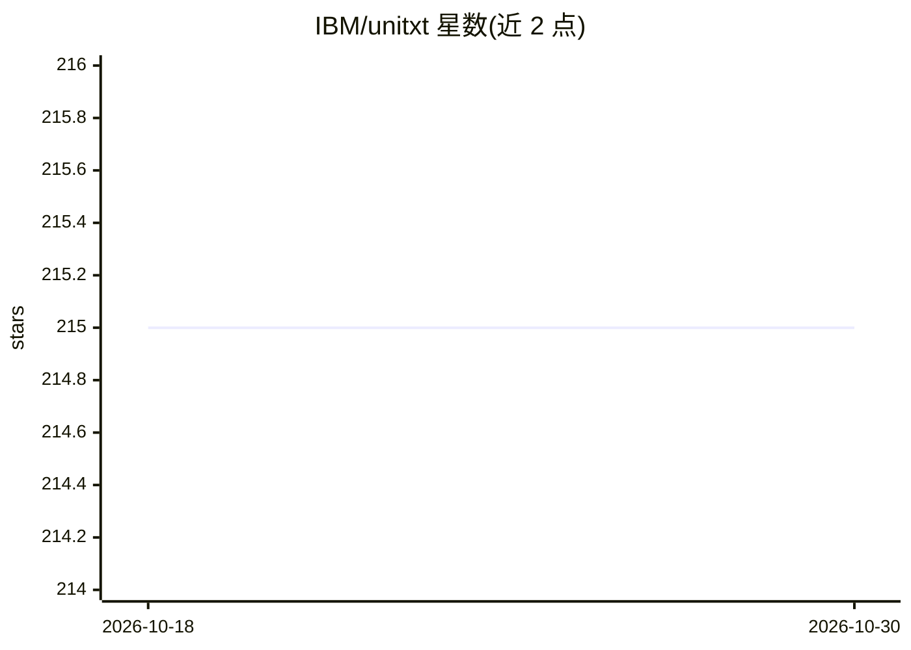

# IBM/unitxt

⭐ 215 · Python · Apache-2.0 · 推送 2026-10-06 · [GitHub](https://github.com/IBM/unitxt) · [官网](https://www.unitxt.ai) · 组织维护

**企业级 AI 评测 Python 库：统一评测文本/表格/视觉/语音/代码**

IBM 维护的 Python 评测库，提供命令行评测工具、Python API（evaluate/create_dataset/load_dataset）与交互式界面（unitxt-explore）。覆盖文本、表格、视觉、语音与代码评测，聚合任务、数据集、提示、基准与指标目录，可将数千个数据集加载为聊天 API 格式供任意模型使用。支持 HuggingFace、OpenAI、WatsonX 及自定义模型接入。有论文（ACL 2024）可供引用。

## 筛选速览

| 维度 | 判定 | 备注 |
|---|---|---|
| AI 角色 | `ai-ecosystem` | LLM/agent 周边工具 |
| 许可风险 | `permissive` | Apache-2.0 |
| 部署形态 | `library` | 以包/库形式分发 |
| 模型依赖 | — | README 未给出锁定关系 |
| 硬件要求 | — | 无带数字的原话,不猜 |
| 安装摩擦 | `low` | 无编译、无系统依赖或容器化 |
| 成熟度 | — | 结构信号不足 |

## 能力要点

- 统一框架评测文本/表格/视觉/语音/代码
- 模型无关：支持 HuggingFace/OpenAI/WatsonX/自定义模型
- 提供 CLI（unitxt-evaluate）与交互式界面（unitxt-explore）
- 可共享的模块化组件保证结果可复现

## 适用场景

- 用 CLI 或 Python API 对模型做基准评测
- 把数千个数据集加载为聊天 API 格式复用
- 在交互界面中浏览数据集与基准

## 场景标签

`模型评测` · 领域:评测与运维

## 证据(README 行号)

> L12: ### 🦄 Unitxt is a Python library for enterprise-grade evaluation of AI performance, offering the world's largest ca
> L18: - 🌐 **Comprehensive**: Evaluate text, tables, vision, speech, and code in one unified framework

## 星数曲线

2026-10-18 215 → 2026-10-30 215（+0）

---
*卡片 v1 · prompt 1.4 · 生成 2026-10-22 · 置信度 high · 依据 README sha `612dd2a75922` · [字段定义](../../DATASET.md)*
