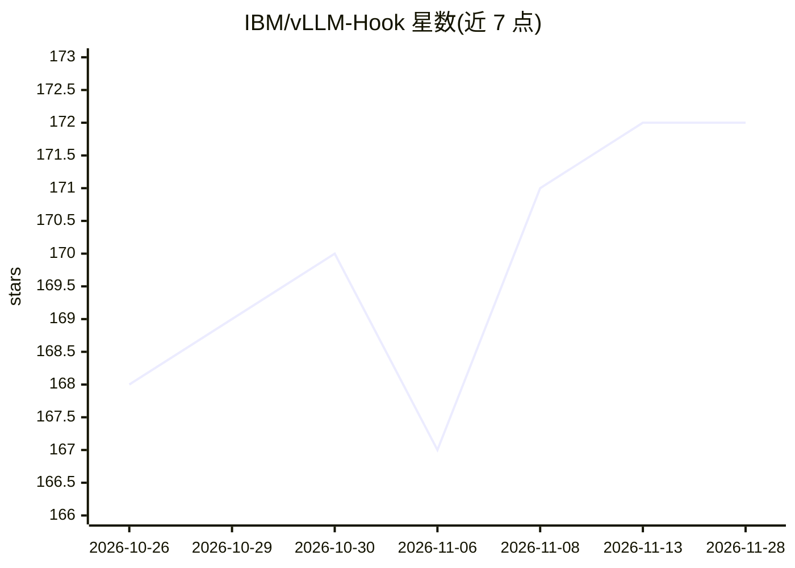

# IBM/vLLM-Hook

⭐ 172 · Python · Apache-2.0 · 推送 2026-11-17 · [GitHub](https://github.com/IBM/vLLM-Hook) · [官网](https://arxiv.org/abs/2603.06588) · 组织维护

**vLLM 插件库：检视、分析与干预运行中 LLM 的内部状态**

IBM Research 开发的 vLLM 插件库（MIA），面向开发者与研究人员，可检视、分析和干预部署在 vLLM 推理引擎上的大模型内部操作，包括注意力模式、注意力头、激活值的动态捕获与激活转向干预。模型无关、无需重写模型文件；以 MiaLLM 离线进程或 vllm serve+MiaClient 服务化两种方式运行，默认在 CUDA graphs 下工作，捕获与转向仅占解码吞吐量几个百分点。要求 Linux、NVIDIA GPU（CUDA 13 驱动）与 vLLM V2 模型运行器，不支持流水线并行。

## 筛选速览

| 维度 | 判定 | 备注 |
|---|---|---|
| AI 角色 | `ai-ecosystem` | LLM/agent 周边工具 |
| 许可风险 | `permissive` | Apache-2.0 |
| 部署形态 | `library` | 以包/库形式分发 |
| 模型依赖 | local-ok | 支持本地模型 |
| 硬件要求 | — | 无带数字的原话,不猜 |
| 安装摩擦 | `medium` | 含编译或系统依赖之一 |
| 成熟度 | — | 结构信号不足 |

## 能力要点

- 模型无关插件系统，不重写模型文件即可接入 vLLM 引擎
- 支持注意力/激活值捕获与激活转向（steering）干预
- 默认保留引擎 CUDA graphs，捕获与转向开销为解码吞吐的百分之几
- 提供安全护栏、重排序、幻觉检测等示例用例

## 适用场景

- 研究 LLM 内部注意力与激活的运行机制
- 为推理服务加入模型内部的安全护栏
- 对已部署模型做激活转向以增强指令遵循
- 构建基于内部状态的幻觉检测器

## 场景标签

`网络安全` `LLM 可观测性` · 领域:评测与运维

## 证据(README 行号)

> L2: *A modular plugin library for vLLM.*
> L8: MIA is a plugin library designed to let developers and researchers **inspect**, **analyze**, and **steer** the inter
> L16: MIA is vLLM-Hook for vLLM 0.32 and its V2 model runner, under CUDA graphs by default. Two ways to run it:

## 星数曲线

2026-10-26 168 → 2026-11-28 172（+4）

---
*卡片 v1 · prompt 1.4 · 生成 2026-11-27 · 置信度 high · 依据 README sha `e605e5682688` · [字段定义](../../DATASET.md)*
