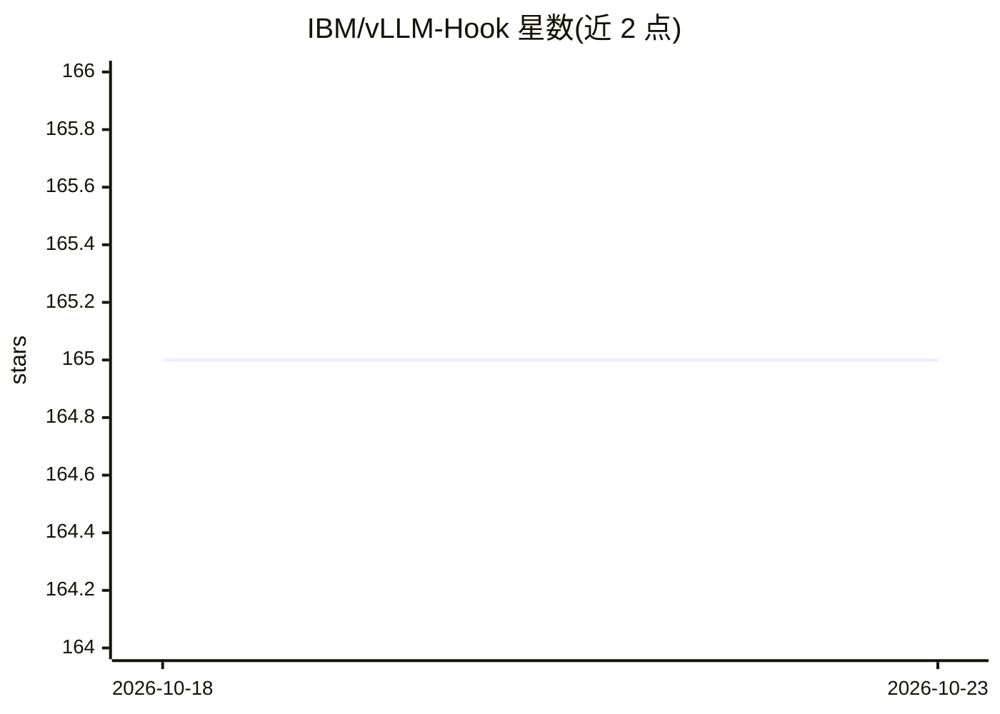

# IBM/vLLM-Hook

⭐ 165 · Python · Apache-2.0 · 推送 2026-10-22 · [GitHub](https://github.com/IBM/vLLM-Hook) · [官网](https://arxiv.org/abs/2603.06588) · 组织维护

**面向 vLLM 的插件库：检查、捕获并干预模型内部状态**

由 IBM Research 开发的 vLLM 插件库（MIA），面向开发者与研究人员，用于在 vLLM 0.29（V2 model runner）推理引擎运行时对 LLM 内部操作做检查、分析与干预（activation steering）。提供 MiaLLM 离线模式与 vllm serve + MiaClient 服务模式两种运行方式；默认在 CUDA graphs 下捕获与干预，捕获/干预带来数个百分点的 decode 吞吐开销。要求 Linux + NVIDIA GPU（CUDA 13 驱动，H100 验证）、Python 3.11-3.14、约 12GB 环境。附带注意力追踪、幻觉检测、reranking 等示例用例。

## 筛选速览

| 维度 | 判定 | 备注 |
|---|---|---|
| AI 角色 | `ai-ecosystem` | LLM/agent 周边工具 |
| 许可风险 | `permissive` | Apache-2.0 |
| 部署形态 | `library` | 以包/库形式分发 |
| 模型依赖 | local-ok | 支持本地模型 |
| 硬件要求 | — | 无带数字的原话,不猜 |
| 安装摩擦 | `medium` | 含编译或系统依赖之一 |
| 成熟度 | — | 结构信号不足 |

## 能力要点

- 模型无关的 vLLM 插件系统，不改写模型文件
- 默认在 CUDA graphs 下捕获隐状态/Q/K/注意力并可做 activation steering
- 支持张量并行（TP>1），流水线并行不支持
- 提供安全护栏、reranking、幻觉检测等示例应用

## 适用场景

- 在 vLLM 服务运行时捕获并分析模型内部激活与注意力模式
- 通过 activation steering 干预模型行为（如增强指令遵循）
- 构建模型内部的安全护栏或幻觉检测用例
- 在脚本/笔记本中离线运行捕获与分析

## 场景标签

 · 领域:LLM 推理/模型可解释性

## 证据(README 行号)

> L8: MIA is a plugin library designed to let developers and researchers **inspect**, **analyze**, and **steer** the inter
> L16: MIA is vLLM-Hook for vLLM 0.29 and its V2 model runner, under CUDA graphs by default. Two ways to run it:

## 星数曲线

2026-10-18 165 → 2026-10-23 165（+0）

---
*卡片 v1 · prompt 1.4 · 生成 2026-10-22 · 置信度 mid · 依据 README sha `dd794ff3e305` · [字段定义](../../DATASET.md)*
