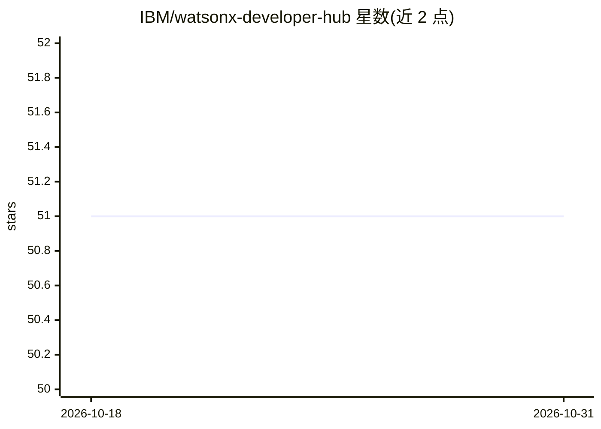

# IBM/watsonx-developer-hub

⭐ 51 · Python · Apache-2.0 · 推送 2026-10-28 · [GitHub](https://github.com/IBM/watsonx-developer-hub) · [官网](https://www.ibm.com/watsonx/developer/) · 组织维护

**面向开发者的 watsonx 平台 Gen AI 示例与指南集合**

IBM 维护的 watsonx Developer Hub，收录使用 watsonx API 构建与部署生成式 AI 应用的示例和指南，内容按 Agents、Apps 等类别组织。开始使用需要三项 watsonx 凭据：项目或空间 ID、区域 endpoint 以及 IBM Cloud API key，均可通过 Developer Access 页面获取。仓库主题标签涉及 agents、langchain、langgraph、llamaindex、autogen、crewai、beeai 等生态关键词，README 可见部分未给出具体安装命令或运行说明。

## 筛选速览

| 维度 | 判定 | 备注 |
|---|---|---|
| AI 角色 | `ai-knowledge` | 知识聚合/清单类 |
| 许可风险 | `permissive` | Apache-2.0 |
| 部署形态 | `None` |  |
| 模型依赖 | — | README 未给出锁定关系 |
| 硬件要求 | — | 无带数字的原话,不猜 |
| 安装摩擦 | `low` | 无编译、无系统依赖或容器化 |
| 成熟度 | — | 结构信号不足 |

## 能力要点

- 按 Agents、Apps 等类别组织示例与指南
- 面向 watsonx APIs 的 Gen AI 应用构建与部署
- 入门说明列出项目/空间 ID、区域 endpoint、IBM Cloud API key 三项凭据

## 适用场景

- 查找 watsonx 平台上构建 Gen AI 应用的示例代码
- 了解如何配置 watsonx API 访问凭据
- 参考 agent 类应用的实现示例

## 场景标签

`精选清单` · 领域:学习与行业

## 证据(README 行号)

> L3: Examples and guides for building and deploying Gen AI applications using the watsonx APIs.
> L5: - Agents

## 星数曲线

2026-10-18 51 → 2026-10-31 51（+0）

---
*卡片 v1 · prompt 1.4 · 生成 2026-10-24 · 置信度 high · 依据 README sha `f0bf65973fd8` · [字段定义](../../DATASET.md)*
