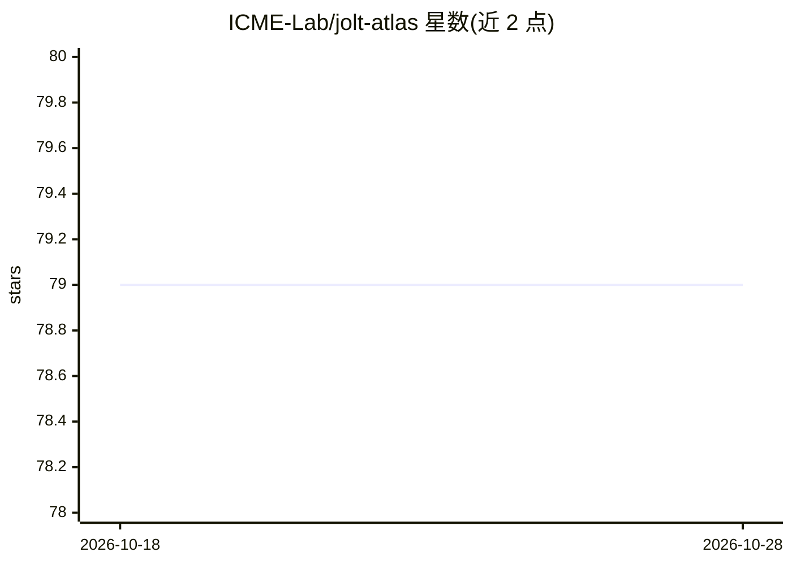

# ICME-Lab/jolt-atlas

⭐ 79 · Rust · NOASSERTION · 推送 2026-10-27 · [GitHub](https://github.com/ICME-Lab/jolt-atlas) · [官网](https://blog.icme.io/sumcheck-good-lookups-good-jolt-good-particularly-for-zero-knowledge-machine-learning/) · 组织维护

**zkML 框架：为 ONNX 模型推理生成零知识证明并验证**

基于 JOLT 证明系统（lookup table + sumcheck）扩展的零知识机器学习框架：读取 ONNX 模型图，执行推理并生成 SNARK 证明，随后可验证该推理的正确性；不依赖电路表示来处理 ReLU/SoftMax 等非线性函数。以 Rust crate 提供，examples 目录内置 GPT-2、nanoGPT、self-attention 等端到端 prove→verify 示例，附基准数据（GPT-2 125M 端到端 16.93 秒）与同机对比 ezkl 的 nanoGPT 数据；需自行安装 Rust/Cargo，GPT-2 的 ONNX 模型需经 Python 脚本从 Hugging Face 下载导出。

## 筛选速览

| 维度 | 判定 | 备注 |
|---|---|---|
| AI 角色 | `ai-ecosystem` | LLM/agent 周边工具 |
| 许可风险 | `none` | NOASSERTION |
| 部署形态 | `None` |  |
| 模型依赖 | — | README 未给出锁定关系 |
| 硬件要求 | — | 无带数字的原话,不猜 |
| 安装摩擦 | `low` | 无编译、无系统依赖或容器化 |
| 成熟度 | — | 结构信号不足 |

## 能力要点

- ONNX 模型推理的 SNARK 证明生成与验证
- 基于 JOLT lookup table，无需电路表示非线性函数
- 内置 GPT-2/nanoGPT/Transformer 等 prove→verify 示例
- 提供 GPT-2（125M）与 nanoGPT 的分阶段基准数据

## 适用场景

- 为 ML 推理结果生成可验证的零知识证明
- 在链上/第三方场景中核验模型确实按声明执行了推理
- 研究 zkML 证明系统在 Transformer 类模型上的性能

## 场景标签

 · 领域:零知识机器学习/密码学基础设施

## 证据(README 行号)

> L3: JOLT Atlas is a zero-knowledge machine learning (zkML) framework that extends the JOLT proving system to support ML 
> L19: Examples live in `jolt-atlas-core/examples/` and demonstrate end-to-end prove → verify flows for various ONNX model

## 星数曲线

2026-10-18 79 → 2026-10-28 79（+0）

---
*卡片 v1 · prompt 1.4 · 生成 2026-10-24 · 置信度 high · 依据 README sha `01f699ef6978` · [字段定义](../../DATASET.md)*
