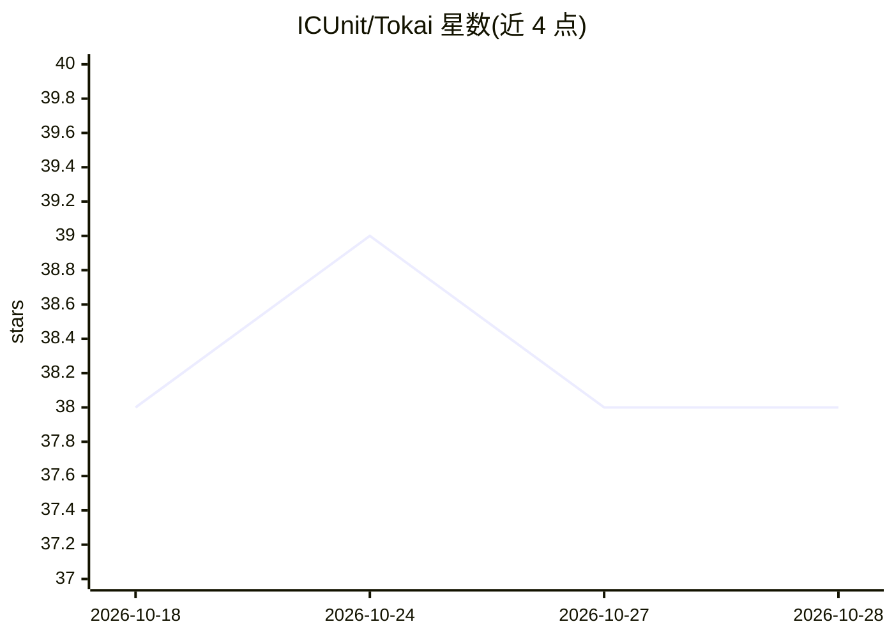

# ICUnit/Tokai

⭐ 38 · TypeScript · NOASSERTION · 推送 2026-08-22 · [GitHub](https://github.com/ICUnit/Tokai) · [官网](https://go.tokai.app) · 组织维护 · 中文 README

**为 ADHD 用户打造的 BCI/自评认知指标驱动 AI 任务规划应用**

面向神经多样性人群（尤其 ADHD）的开源生产力 Web 应用：通过四种数据源（自我回报、AR(1) 模拟、STEW/DEAP 数据集档案、实时 EEG 头戴设备 Beta）驱动九项认知指标的实时仪表板，并由 Claude 驱动的 TokAgent 助手结合神经指标、任务、日志与用药记录给出情境感知的规划建议；配套专注感知任务管理器 TokDo、连动脑数据的番茄钟、本机洞察、日志与用药记录。默认自我回报模式无需任何硬件即可完整使用。前端 React 19 + Supabase，自托管需运行迁移、配置 Anthropic 金钥（或用户自备）并部署到 Vercel。

## 筛选速览

| 维度 | 判定 | 备注 |
|---|---|---|
| AI 角色 | `ai-enhanced` | 去掉 AI 部分产品仍成立 |
| 许可风险 | `none` | NOASSERTION |
| 部署形态 | `library` | 以包/库形式分发 |
| 模型依赖 | locked-api |  |
| 硬件要求 | — | 无带数字的原话,不猜 |
| 安装摩擦 | `low` | 无编译、无系统依赖或容器化 |
| 成熟度 | `idea` | |

## 能力要点

- 九项实时认知指标仪表板，指标卡带数据来源徽章（EEG/EST/SELF/SIM/COMP/LIVE）
- Claude 驱动的 TokAgent 读取实时神经指标与任务清单给出规划建议
- 四种神经数据源：自我回报（默认）/ 模拟 / STEW+DEAP 数据集 / 实时 EEG（Beta）
- TokInsights 洞察在本机计算，不调用 API

## 适用场景

- 我患有 ADHD，想根据当天大脑实际状态安排任务
- 用专注度连动的番茄钟在专注下降时提醒休息
- 记录情绪、用药并查看其与专注指标的关系
- 接入 EEG 头戴设备观察实时认知指标（Beta）

## 场景标签

`AI 助手` · 领域:对话与助手

## 证据(README 行号)

> L23: **Tokai** is an open-source, neurosupportive productivity app built for neurodivergent brains — especially people w
> L51: |🤖|**TokAgent** — a Claude-powered assistant in a slide-up **bottom dock**. Reads your live neural metrics, full ta

## 星数曲线

2026-10-18 38 → 2026-10-28 38（+0）

---
*卡片 v1 · prompt 1.4 · 生成 2026-10-25 · 置信度 mid · 依据 README sha `08b6367e4864` · [字段定义](../../DATASET.md)*
