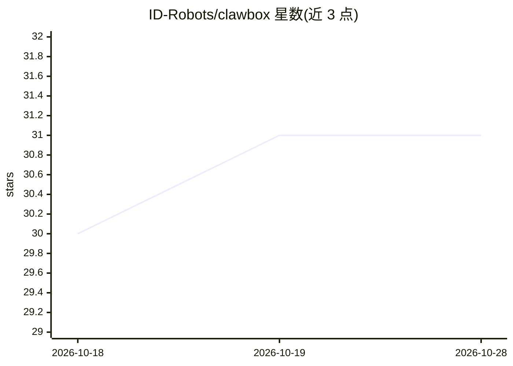

# ID-Robots/clawbox

⭐ 32 · TypeScript · NOASSERTION · 推送 2026-10-28 · [GitHub](https://github.com/ID-Robots/clawbox) · [官网](https://clawbox.com) · 组织维护

**运行在 NVIDIA Jetson 上的私人 AI 助手整机及配套操作系统**

ID Robots Ltd. 生产的桌面级 AI 助手硬件：NVIDIA Jetson Orin Nano 8GB，67 TOPS，512GB NVMe，7–15 W 供电，预装 Gemma 4 并通过自带 llama.cpp 在设备上推理，支持 Local-only 模式关闭所有云端。本仓库为其出厂系统 OpenClaw OS：OpenClaw AI agent 通过 MCP 工具（最多 78 个）操作整机，提供 Chrome OS 风格桌面、引导式 5 分钟设置向导、多用户、Memory Shard 索引、Coding Agent、多平台消息接入与 ClawKeep 加密备份。云端 AI（Claude/GPT/Gemini）为可选接入，部分功能需 Pro 或 Max 订阅。

## 筛选速览

| 维度 | 判定 | 备注 |
|---|---|---|
| AI 角色 | `ai-native` | 本体是模型或模型工具 |
| 许可风险 | `none` | NOASSERTION |
| 部署形态 | `None` |  |
| 模型依赖 | — | README 未给出锁定关系 |
| 硬件要求 | — | 无带数字的原话,不猜 |
| 安装摩擦 | `low` | 无编译、无系统依赖或容器化 |
| 成熟度 | — | 结构信号不足 |

## 能力要点

- 设备端本地推理：预装 Gemma 4 运行于自带 llama.cpp，可离线工作
- OpenClaw agent 经最多 78 个 MCP 工具操作整机
- Chrome OS 风格桌面、引导设置向导与多用户账户
- Telegram/Discord/WhatsApp/邮件及网页聊天多平台接入

## 适用场景

- 购置一台即插即用的本地优先 AI 助手设备，数据不出盒子
- 让 AI agent 通过语音或聊天代为操作整个系统与应用
- 远程访问私有 AI 助手并自动备份设备快照

## 场景标签

`AI 助手` `编码 Agent` · 领域:编码与开发

## 证据(README 行号)

> L27: **ClawBox is a dedicated personal AI assistant appliance made by ID Robots Ltd. that runs the OpenClaw AI agent.** 
> L31: **Real on-device inference, not a cloud relay.** Every ClawBox ships with Gemma 4 preinstalled on its own llama.cpp

## 星数曲线

2026-10-18 30 → 2026-10-28 31（+1）

---
*卡片 v1 · prompt 1.4 · 生成 2026-10-26 · 置信度 high · 依据 README sha `02a366f23da9` · [字段定义](../../DATASET.md)*
