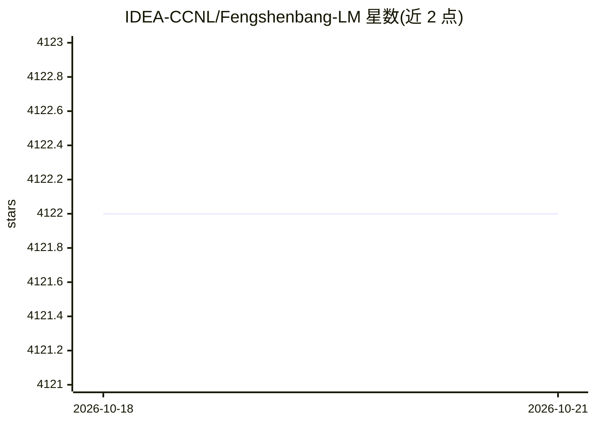

# IDEA-CCNL/Fengshenbang-LM

⭐ 4,122 · Python · Apache-2.0 · 推送 2026-06-08 · [GitHub](https://github.com/IDEA-CCNL/Fengshenbang-LM) · 组织维护 · 中文 README

**中文大模型开源体系：预训练模型系列与训练微调框架**

IDEA 研究院 CCNL 中心主导的中文大模型开源体系，包含七个模型系列：姜子牙通用大模型（含 Ziya-LLaMA、Ziya-BLIP2 视觉模型）、二郎神语言理解、闻仲语言生成、燃灯文本转换、太乙多模态（含首个中文 Stable Diffusion）、余元领域模型等。所有模型同步至 HuggingFace，用 transformers/diffusers 加载。配套 FengShen（封神）框架，基于 PyTorch 与 PyTorch-Lightning，支持 TB 级数据、百亿参数预训练、分布式训练与命令行 Pipeline 微调。提供 Docker 镜像。Apache 2.0 许可。

## 筛选速览

| 维度 | 判定 | 备注 |
|---|---|---|
| AI 角色 | `ai-native` | 本体是模型或模型工具 |
| 许可风险 | `permissive` | Apache-2.0 |
| 部署形态 | `self-host` | docker 或自建部署 |
| 模型依赖 | — | README 未给出锁定关系 |
| 硬件要求 | — | 无带数字的原话,不猜 |
| 安装摩擦 | `low` | 无编译、无系统依赖或容器化 |
| 成熟度 | — | 结构信号不足 |

## 能力要点

- 七个模型系列覆盖通用、多模态、领域任务，均同步至 HuggingFace
- Ziya 系列经历预训练、多任务有监督微调、人类反馈学习三阶段
- FengShen 框架支持百亿级参数分布式预训练与命令行一键 Predict/Finetune
- 提供含 torch/cuda 环境的 Docker 镜像

## 适用场景

- 下载中文预训练模型做下游任务的微调与推理
- 用 FengShen 框架做大规模分布式预训练
- 使用中文 Stable Diffusion 模型生成文本图像

## 场景标签

`模型训练` `微调` `多模态` `图像生成` · 领域:内容生成

## 证据(README 行号)

> L76: “封神榜模型”将全方面的开源一系列NLP相关的预训练大模型。NLP社区中有着广泛的研究任务，这些任务可以被分为两类：通用任务和特殊任务。前者包括了自然语言理解(NLU)，自然语言生成(NLG)和自然语言转换(NLT)任务。后者涵盖
> L88: 通用大模型“姜子牙”系列，具备翻译，编程，文本分类，信息抽取，摘要，文案生成，常识问答和数学计算等能力。目前姜子牙通用大模型(v1/v1.1)已完成大规模预训练、多任务有监督微调和人类反馈学习三阶段的训练过程。姜子牙系列模型包含以
> L164: 太乙系列模型主要应用于跨模态场景，包括文本图像生成，蛋白质结构预测, 语音-文本表示等。2022年11月1日，封神榜开源了第一个中文版本的 stable diffusion 模型“太乙 Stable Diffusion”。

## 星数曲线

2026-10-18 4,122 → 2026-10-21 4,122（+0）

---
*卡片 v1 · prompt 1.4 · 生成 2026-10-20 · 置信度 high · 依据 README sha `8238b5c16e9c` · [字段定义](../../DATASET.md)*
