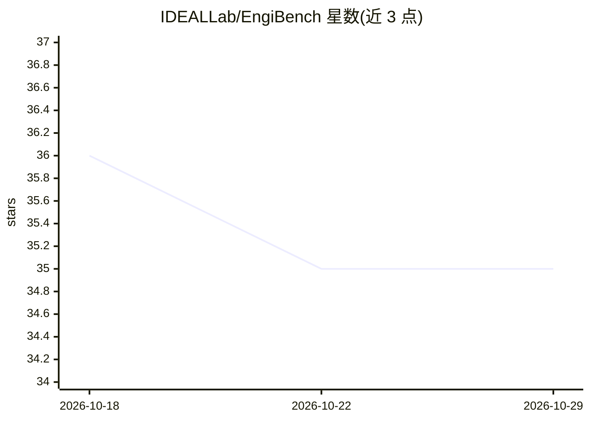

# IDEALLab/EngiBench

⭐ 35 · Python · GPL-3.0 · 推送 2026-09-30 · [GitHub](https://github.com/IDEALLab/EngiBench) · [官网](https://engibench.ethz.ch/) · 组织维护

**工程设计优化与机器学习算法的标准评测基准库**

提供一组工程设计问题、数据集与基准，用统一 API 支持研究者在其上开发和评估优化及机器学习算法，便于跨问题比较。覆盖 beams2d 等多种问题，各问题可按需安装附加依赖，部分问题在 Docker 或 Singularity 下运行、部分需原生安装依赖。配套开源项目 EngiOpt 提供兼容 API 的算法实现，并提供 Colab notebook 交互。采用 GPLv3 许可，发表于 2025 年论文。

## 筛选速览

| 维度 | 判定 | 备注 |
|---|---|---|
| AI 角色 | `ai-ecosystem` | LLM/agent 周边工具 |
| 许可风险 | `viral` | GPL-3.0 |
| 部署形态 | `library` | 以包/库形式分发 |
| 模型依赖 | — | README 未给出锁定关系 |
| 硬件要求 | — | 无带数字的原话,不猜 |
| 安装摩擦 | `low` | 无编译、无系统依赖或容器化 |
| 成熟度 | — | 结构信号不足 |

## 能力要点

- 统一 API 的工程设计问题/数据集/基准集合
- 按问题可选安装附加依赖（如 engibench[beams2d]）
- 部分问题以 Docker/Singularity 运行
- 配套 EngiOpt 提供兼容算法实现，含 Colab notebook

## 适用场景

- 在同一组工程设计问题上比较不同优化/ML 算法
- 为工程设计相关研究提供标准化评测数据集
- 通过统一 API 快速接入新问题做实验

## 场景标签

`模型评测` · 领域:评测与运维

## 证据(README 行号)

> L11: EngiBench offers a collection of engineering design problems, datasets, and benchmarks to facilitate the developmen
> L41: You can also play with the API here: Open In Colab. We also provide good quality implementations of algorithms comp

## 星数曲线

2026-10-18 36 → 2026-10-29 35（-1）

---
*卡片 v1 · prompt 1.4 · 生成 2026-10-25 · 置信度 high · 依据 README sha `32a37dd56abf` · [字段定义](../../DATASET.md)*
